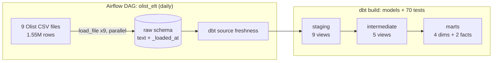
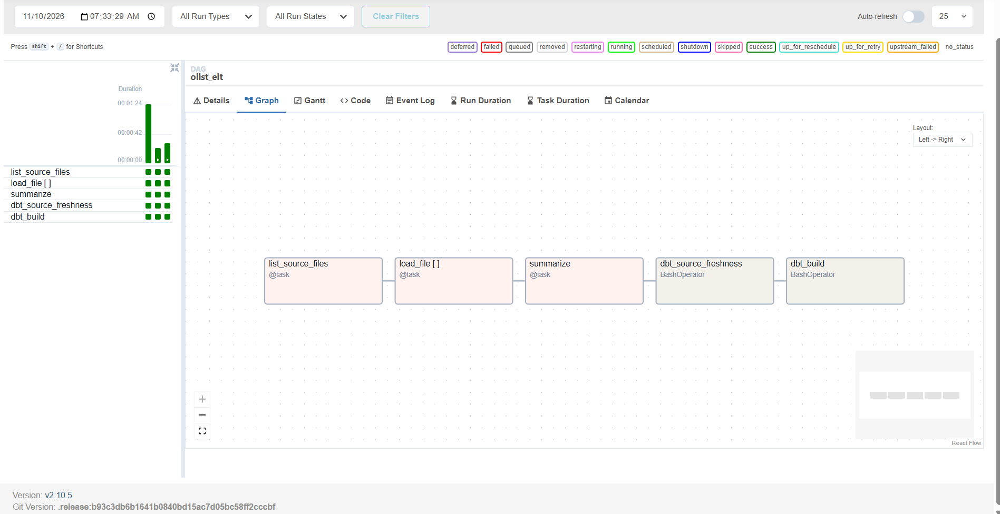
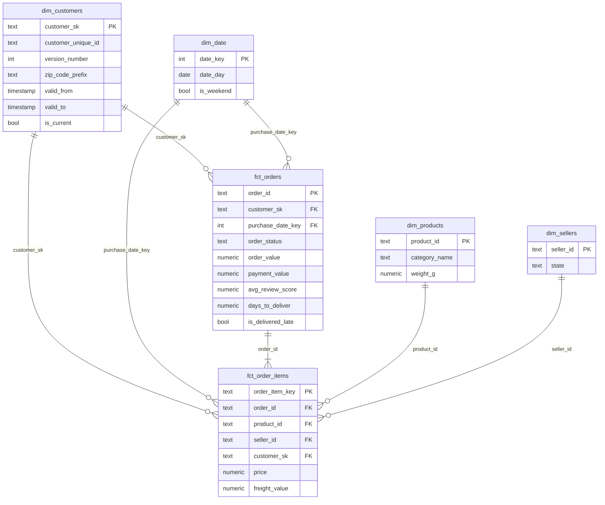

# Batch ELT: Olist to a Star-Schema Warehouse with Airflow and dbt

[](https://github.com/Frenwin/Portfolio/actions/workflows/de-01-elt-airflow-dbt.yml)

> Loads **1.55 million rows** from 9 raw CSV files into a tested star-schema warehouse in **~30 seconds**, with **70 data tests**, an SCD Type 2 customer dimension rebuilt from order history, and CI on every push.

**Role:** Data Engineer · **Built:** 2026-11-10 · **Status:** Done · Part of [16 projects in 4 weeks](../../README.md)

## Problem

An e-commerce marketplace keeps its data in separate operational exports: orders, items, payments, reviews, customers, sellers, products. Analysts need one trustworthy model to answer questions like *"Do late deliveries hurt review scores?"* without re-cleaning the raw files each time.

This project builds that model: an orchestrated, idempotent ELT pipeline that lands raw data, cleans it, and publishes fact and dimension tables that are tested on every run.

## Architecture





| Layer | Tool | What happens |
| --- | --- | --- |
| Orchestration | Airflow 2.10 (LocalExecutor) | Daily DAG: list files → load each in parallel → summarize → freshness check → `dbt build` |
| Ingestion | Python + `COPY` | Each file replaces its `raw` table inside one transaction; row count is checked against the file before commit |
| Transformation | dbt 1.12 on PostgreSQL 16 | staging → intermediate → marts, with tests running right after each model |
| CI | GitHub Actions | pytest, load a 450-order sample, `dbt build`, DAG import check |

## Data model



Full column descriptions: [docs/data_dictionary.md](docs/data_dictionary.md).

## Results

| Metric | Value |
| --- | --- |
| Raw rows loaded | 1,550,922 across 9 tables |
| Full pipeline run (load + freshness + build), warm | ~29 s |
| Re-run on unchanged data | identical row counts in every table (idempotent) |
| dbt models | 20 (9 staging, 5 intermediate, 6 marts; 1 incremental) |
| dbt data tests | 70 passing, 1 deliberate warning |
| `fct_orders` / `fct_order_items` | 99,441 / 112,650 rows |
| `dim_customers` (SCD2) | 96,355 versions for 96,096 customers |

### What the data quality work found

| Finding | How it is handled |
| --- | --- |
| `review_id` is not unique (99,224 rows, 98,410 ids): one review can be attached to several orders | Grain set to `(review_id, order_id)` with a tested `review_key` |
| Olist issues a new `customer_id` per order; 2,997 customers have several ids, and **252 changed address** (up to 4 versions) | `dim_customers` is rebuilt as SCD Type 2 from order history; facts point to the version valid at purchase time |
| 42 geolocation points fall outside Brazil | Filtered by bounding box before averaging per zip code |
| 2 product categories have no English name; 610 products have no category | Fall back to the Portuguese name, then `unknown` |
| 246 delivered orders are paid more than 1 BRL away from items + freight; 236 of them are credit card, +12.16 BRL on average | Kept as a **warning** test: consistent with instalment interest, not a pipeline bug |
| Source column typo `product_name_lenght` | Renamed in staging |

The cleaned model already answers a business question for next week's analysis: **6.8% of delivered orders arrive late, and those orders average a 2.27 review score versus 4.29 when on time.**

## How to run

Requirements: Docker Desktop with about 4 GB RAM free and 3 GB disk for images.

```powershell
# 1. Get the data (public Kaggle dataset, ~45 MB zip)
curl.exe -L -o olist.zip https://www.kaggle.com/api/v1/datasets/download/olistbr/brazilian-ecommerce
Expand-Archive olist.zip -DestinationPath data/raw

# 2. Start Postgres + Airflow; the DAG is unpaused and runs on startup
docker compose up -d --build

# 3. Watch it in the Airflow UI: http://localhost:8080 (admin / admin)
```

Query the result (warehouse on `localhost:5434`, user/password `warehouse`):

```powershell
docker compose exec postgres psql -U warehouse -d warehouse -c "select order_status, count(*) from marts.fct_orders group by 1 order by 2 desc;"
```

No Kaggle access? Load the bundled 450-order sample instead: copy `data/sample/*.csv` to `data/raw/`.

Run the tests and dbt locally without Airflow:

```powershell
python -m venv .venv; .\.venv\Scripts\Activate.ps1
pip install -r requirements-dev.txt
$env:RUN_DB_TESTS = "1"; pytest -q tests
python -m ingestion.load_raw --data-dir data/sample
cd dbt; dbt build --profiles-dir .
```

## Project structure

```text
de-01-elt-airflow-dbt/
├── docker-compose.yml          # Postgres 16 + Airflow webserver/scheduler
├── airflow/Dockerfile          # Airflow 2.10.5 + dbt in its own virtualenv
├── dags/olist_elt.py           # the DAG
├── ingestion/load_raw.py       # idempotent CSV → raw loader (COPY, one transaction per file)
├── dbt/
│   ├── models/staging/         # 9 views, 1:1 with sources
│   ├── models/intermediate/    # aggregates + SCD2 versioning
│   ├── models/marts/           # dim_* and fct_*
│   ├── tests/                  # 4 singular tests (SCD2 integrity, amounts, reconciliation)
│   └── macros/                 # schema naming
├── tests/                      # pytest for the loader
├── scripts/make_sample.py      # builds the referentially consistent CI sample
├── data/sample/                # 450 orders used by CI
└── docs/                       # ADR + data dictionary
```

## Key decisions

- **ELT, not ETL.** Raw data lands as text and is typed in dbt, so a bad cast fails a visible model instead of silently breaking ingestion. ([ADR-001](docs/adr/001-stack-and-loading.md))
- **Truncate + COPY in one transaction.** Re-runs are idempotent, a failed load keeps yesterday's data, and dependent views survive.
- **SCD2 from history instead of snapshots.** The source is a static export, so a dbt snapshot would only ever hold one version. The address history is already in the data; deriving it shows real changes today, and a snapshot can capture future ones.
- **Incremental fact with a lookback window.** `fct_order_items` reprocesses only the last `lookback_days` (default 3) of orders, using delete+insert on the key.
- **Warn, don't fail, on known business variance.** Payment reconciliation differences are reported every run without blocking the pipeline.

## Limitations & next steps

- Raw files are full exports, so each run reloads everything; a real source would use incremental extraction or CDC ([DE-4](../README.md)).
- `fct_orders` is rebuilt fully each run; late status changes on old orders are handled, but at full-table cost.
- Add a BigQuery target to `profiles.yml` and publish `dbt docs` to GitHub Pages.
- Alert on DAG failure (Slack or email callback).

## Tech stack

Python 3.11 · Apache Airflow 2.10.5 · dbt-core 1.12.6 + dbt-postgres 1.11.0 · PostgreSQL 16 · Docker Compose · GitHub Actions · pytest

## Data source

[Brazilian E-Commerce Public Dataset by Olist](https://www.kaggle.com/datasets/olistbr/brazilian-ecommerce), published on Kaggle under CC BY-NC-SA 4.0. The sample in `data/sample/` is a subset of that dataset, redistributed under the same license.
