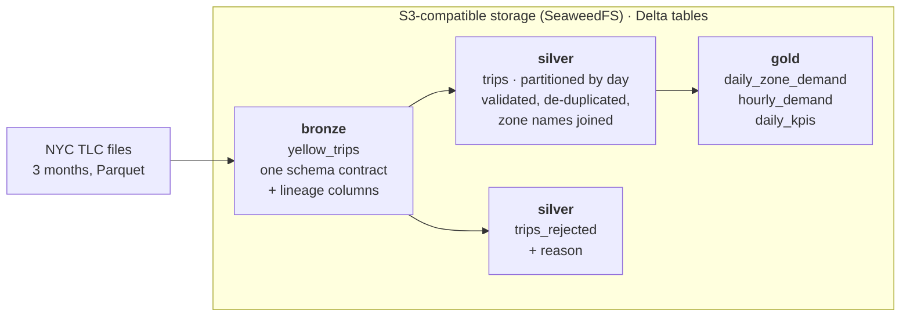

# DE-2 · Lakehouse: NYC Taxi Bronze → Silver → Gold on Delta Lake

[](https://github.com/Frenwin/Portfolio/actions/workflows/de-02-lakehouse-spark-delta.yml)


[← Week 1 · Data Engineer](../) · [Portfolio home](../../README.md)

> Turns **9.55 million** raw taxi trips into a validated, de-duplicated and query-ready lakehouse on S3-compatible storage, where any month can be re-processed safely. Re-thinking one MERGE cut silver processing from **674 s to 256 s**.

## At a glance

| | |
| --- | --- |
| **Problem** | Three months of public taxi data arrive as large monthly files whose schema changes between months, with impossible trips (negative fares, trips ending before they start, trips dated outside their file's month) mixed in |
| **What I built** | A PySpark pipeline that lands files in a bronze Delta table, validates and enriches them into silver, and publishes daily and hourly aggregates in gold, all on S3-compatible object storage |
| **Result** | 9.55M rows in · 9.21M valid trips out · 348K rejected with a reason · re-running a month changes nothing |
| **Why it matters** | Analysts query clean, partitioned tables instead of raw files, and a corrected source month can be re-loaded without duplicates |
| **Run it** | `python scripts/download_tlc.py` then `docker compose run --rm spark` |
| **Built** | 2026-11-12 in one day · Role: Data Engineer |

**Contents:** [Problem](#problem) · [Architecture](#architecture) · [Results](#results) · [How to run](#how-to-run) · [Key decisions](#key-decisions) · [Limitations](#limitations--next-steps)

## Problem

A raw data lake is a folder of files: nobody knows which rows are valid, re-loading a file duplicates it, and every query scans everything. The NYC TLC trip files show all three problems at real scale: ~3 million rows per month, a column renamed between months (`Airport_fee` → `airport_fee`), types that change (`passenger_count` as int or double), and records that cannot be real.

A lakehouse fixes this with layers and a table format that supports transactions, upserts and time travel on cheap object storage.

## Architecture



| Layer | What happens | Re-run behaviour |
| --- | --- | --- |
| **Bronze** | Renames drifted columns, casts to one schema, adds `source_month`, `_source_file`, `_ingested_at`. Nothing is filtered. | `replaceWhere` on the month's partition |
| **Silver** | 7 validation rules; failing rows go to `trips_rejected` with the first rule they broke. Content hash `trip_id` removes exact duplicates. Pickup and drop-off zones joined. Partitioned by `pickup_date`. | Two MERGEs pruned to the month: insert new trips, delete withdrawn ones |
| **Gold** | Daily demand per pickup zone, hourly demand and speed, daily KPIs (revenue, card share, airport pickups) | Rebuilt from silver |
| **Maintenance** | `OPTIMIZE … ZORDER BY (pu_location_id)` on silver | Safe to repeat |

## Results

### Data quality

| | Rows |
| --- | ---: |
| Raw trips (Jan–Mar 2024) | 9,554,778 |
| Valid trips in silver | 9,206,805 |
| Rejected with a reason | 347,972 |
| Exact duplicates removed | 1 |

| Rejection reason | Rows | Likely cause |
| --- | ---: | --- |
| `non_positive_distance` | 213,243 | Meter started and stopped without moving, or a GPS fault |
| `negative_amount` | 126,269 | Voided or refunded fares recorded as negative amounts |
| `duration_over_6h` | 5,434 | Meter left running |
| `dropoff_not_after_pickup` | 2,801 | Clock or entry errors |
| `distance_over_200_miles` | 169 | Odometer or GPS errors |
| `pickup_outside_file_month` | 56 | Trips dated outside the month of the file they arrived in |

### What the design buys

| Measure | Result |
| --- | --- |
| Silver processing, 3 months | **674 s → 256 s** after replacing one MERGE with two pruned MERGEs ([why](docs/adr/001-storage-and-sync.md)) |
| One-day query, trips per zone | 0.54 s on bronze → 0.28 s on silver (median of 5 runs). Delta's file statistics already let bronze skip most files; daily partitions halve the rest |
| Re-running January through silver | 0 rows inserted, 0 deleted (52 s): safe to re-load a corrected month |
| Time travel | Version 0 (January only, 2,868,204 rows) is still queryable after March was added |
| Full pipeline (bronze + silver + gold + optimize) | 860 s → 378 s on a laptop (Spark local mode, Docker with 8 GB RAM) |

Full numbers: [docs/benchmark.md](docs/benchmark.md).

## How to run

```powershell
python scripts/download_tlc.py                         # ~160 MB: 3 months + zone lookup into data/landing
docker compose up -d seaweedfs                         # S3 API on :8333, file browser on :8888
docker compose run --rm spark                          # bronze -> silver -> gold -> optimize
docker compose run --rm spark python -m benchmarks.benchmark   # writes docs/benchmark.md
docker compose run --rm spark pytest -q tests          # 6 tests on local Delta tables
```

Spark UI is on http://localhost:4040 while a job runs.

<details>
<summary><b>Project structure</b></summary>

```text
de-02-lakehouse-spark-delta/
├── docker-compose.yml       # SeaweedFS (S3) + Spark job container
├── spark/Dockerfile         # Python 3.11, Java 17, PySpark 3.5.3, Delta 3.2.1, jars cached at build
├── s3/s3.json               # S3 access key for the lakehouse bucket
├── lakehouse/
│   ├── config.py            # table paths, Spark session, s3a settings
│   ├── bronze.py            # schema contract for drifting source files
│   ├── silver.py            # validation rules, de-dup, month sync
│   ├── gold.py              # aggregates
│   └── pipeline.py          # end-to-end run + OPTIMIZE
├── benchmarks/benchmark.py  # partition pruning, compaction, time travel, idempotency
├── scripts/download_tlc.py
├── tests/                   # schema drift, idempotency, reject reasons, sync deletes, gold totals
└── docs/                    # ADR + benchmark results
```

</details>

## Key decisions

- **One schema contract in bronze.** Source drift is absorbed once, at the edge, instead of breaking every downstream query. Bronze keeps every row, so nothing is lost before validation.
- **Reject with a reason, never silently drop.** Every removed row is queryable in `trips_rejected` with the rule it broke, so the rules can be audited and tuned.
- **Content hash as the trip key.** TLC data has no trip id; hashing the trip's fields makes exact duplicates collapse and makes the month sync idempotent.
- **Two pruned MERGEs instead of one.** A single `WHEN NOT MATCHED BY SOURCE` clause scanned the whole table, so each month got slower. Splitting it keeps every MERGE inside one month's partitions. ([ADR-001](docs/adr/001-storage-and-sync.md))
- **SeaweedFS instead of MinIO.** MinIO's community images are no longer published; SeaweedFS speaks the same S3 API through the standard `s3a://` connector, so moving to AWS S3 is a configuration change.

## Limitations & next steps

- Spark runs in local mode in one container; on a cluster the same code would scale out, but cluster tuning is not shown here.
- Delta's default S3 log store supports one writer per table; concurrent writers would need a DynamoDB log store.
- `VACUUM` is not scheduled, so old file versions are kept (useful for time travel, costly over time).
- Next: run gold incrementally instead of full rebuilds, and register tables in a catalog (Unity Catalog or Hive Metastore).

## Tech stack

Python 3.11 · PySpark 3.5.3 · Delta Lake 3.2.1 · SeaweedFS 4.52 (S3 API) · hadoop-aws 3.3.4 · Docker Compose · GitHub Actions · pytest

## Data source

[NYC Taxi & Limousine Commission trip records](https://www.nyc.gov/site/tlc/about/tlc-trip-record-data.page), yellow taxi, January–March 2024, published by the City of New York.

---

[← Week 1 · Data Engineer](../) · [Portfolio home](../../README.md)
