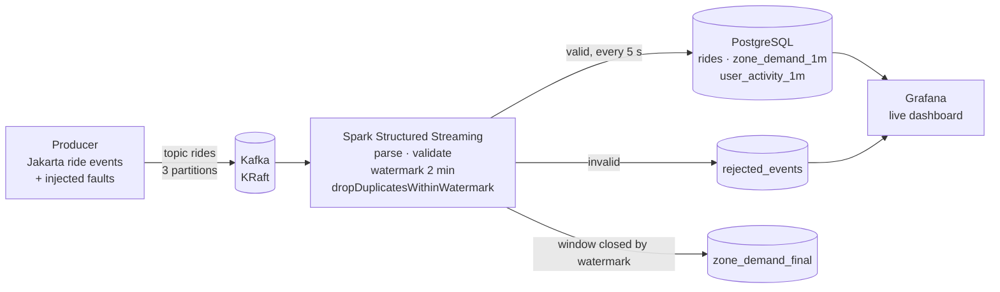
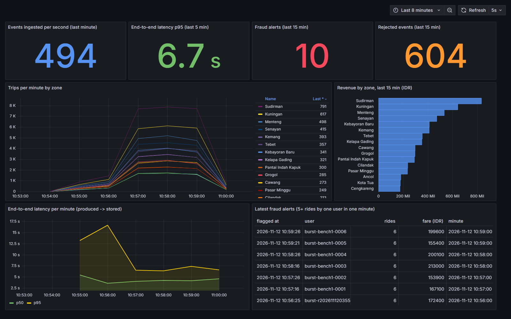

# DE-3 · Real-Time Ride Events: Kafka → Spark Structured Streaming → Grafana

[](https://github.com/Frenwin/Portfolio/actions/workflows/de-03-realtime-kafka-spark.yml)


[← Week 1 · Data Engineer](../) · [Portfolio home](../../README.md)

> Processes ~1,000 ride events per second from a Jakarta ride-hailing simulation with **exactly-once results** despite duplicates, late events and replays: **178,736 of 178,736** rides stored once, **8 of 8** fraud bursts flagged in under 6 seconds, p95 latency **6.4 s**.

## At a glance

| | |
| --- | --- |
| **Problem** | Ride events arrive as a stream that is never clean: retries re-send events, phones send them late, some messages are broken. A live dashboard and a fraud rule built on that stream must still count every ride exactly once. |
| **What I built** | A producer that injects realistic faults into Kafka, a Spark Structured Streaming job with watermarking and de-duplication, an idempotent PostgreSQL sink, and a Grafana dashboard that updates every 5 seconds |
| **Result** | 178,736 of 178,736 rides stored exactly once · 8/8 fraud bursts caught, 0 false alerts · p95 latency 6.4 s at ~940 rides/s |
| **Why it matters** | Operations sees demand per zone and suspicious users within seconds, and the numbers are correct even when the job crashes and replays |
| **Run it** | `docker compose up -d --build` → dashboard at `localhost:3000` |
| **Built** | 2026-11-12 in one day · Role: Data Engineer |

**Contents:** [Problem](#problem) · [Architecture](#architecture) · [Results](#results) · [How to run](#how-to-run) · [Key decisions](#key-decisions) · [Limitations](#limitations--next-steps)

## Problem

Batch pipelines (DE-1, DE-2) answer "what happened yesterday". A ride-hailing company also needs to know what is happening **now**: which zones are short of drivers, and which account is taking five rides in a minute because it is being abused. Streaming data brings problems batch data does not:

| Fault | Real cause | Wrong result if ignored |
| --- | --- | --- |
| Duplicate events | Producer retries after a timeout | Rides and revenue counted twice |
| Late events | Phone offline in a tunnel, sends later | Ride counted in the wrong minute, or never |
| Very late events | Device clock or replay from hours ago | State grows forever waiting for them |
| Malformed messages | App bug, truncated payload | Job crashes, or bad rows silently dropped |
| Job crash and replay | Deploy, out-of-memory, node loss | Every replayed batch double-counted |

## Architecture





| Step | Tool | What happens |
| --- | --- | --- |
| Produce | Python + confluent-kafka | Ride events for 16 Jakarta zones at a set rate; 1% duplicates, 2% late (20-90 s), 0.5% too late (5-10 min), 0.3% malformed, 2 fraud bursts per minute |
| Validate | Spark | JSON parsed against a schema; invalid rows go to `rejected_events` with a reason and their Kafka offset |
| De-duplicate | Spark | `withWatermark("event_ts", "2 minutes")` + `dropDuplicatesWithinWatermark("event_id")` |
| Store | PostgreSQL via `foreachBatch` | One statement inserts new rides and updates per-minute zone demand and per-user activity from only the rows that were new |
| Detect fraud | PostgreSQL | A user's counter reaching 5 rides in one minute sets `flagged_at` once |
| Finalise | Spark | Per-minute windows emitted once the watermark passes, for numbers that never change afterwards |
| Show | Grafana | Throughput, latency p95, trips per zone, revenue per zone, fraud alerts, rejected events |

## Results

Measured on a laptop (Spark local mode in Docker), 3 minutes at ~1,000 events/s. Full output: [docs/results.md](docs/results.md).

### Correctness

| Injected fault | Sent | What happened |
| --- | ---: | --- |
| Unique valid rides | 178,736 | **178,736 stored, exactly once** |
| Duplicate re-sends | 1,762 | 0 extra rows |
| Late events (20-90 s old) | 3,771 | all 3,771 kept, counted in the minute they happened |
| Too-late events (5-10 min old) | 754 | all dropped by the watermark, 0 stored |
| Malformed messages | 558 | all 558 in `rejected_events` with their Kafka offset |
| Fraud bursts (6 rides in 15 s) | 8 | **8 detected, 0 false alerts** |
| Job killed mid-stream (`docker kill`) and restarted | 1 | down 18 s during a 600 events/s run: **89,342 of 89,342 rides stored once**, 4/4 bursts flagged, backlog cleared in one batch ([details](docs/crash-test.md)) |

Real-time (`zone_demand_1m`) and watermark-final (`zone_demand_final`) counts agree on **48 of 48** zone-minutes.

### Speed

| Metric | Value |
| --- | ---: |
| Throughput stored | 939 rides/s |
| End-to-end latency p50 / p95 / p99 (produced → in PostgreSQL) | 4.1 / 6.4 / 7.6 s |
| Fraud detection latency p50 / max (5th ride → flag) | 3.6 / 5.4 s |
| Micro-batch size (avg / max) | 3,694 / 4,987 rows every 5 s |

Latency is dominated by the 5-second trigger; a shorter trigger lowers it at the cost of more, smaller writes.

### A bug the reconciliation caught

The first measured run stored **2.6% fewer rides than were sent**, with no errors anywhere. The report made it visible: event ids came from a seeded random generator, so an earlier demo run with the same seed had produced the *same ids*. The idempotent sink did exactly what it should, treating them as duplicates, and silently discarded real rides. Ids are now namespaced by run (`uuid5(namespace, run_id + random bits)`), a regression test covers it, and the rerun matched exactly. Idempotency keys must be globally unique, not just unique within one producer.

## How to run

```powershell
docker compose up -d --build        # Kafka, Postgres, Grafana, Spark job, producer at 200 events/s
start http://localhost:3000         # live dashboard (no login needed to view)
docker compose logs -f spark-job    # streaming job logs; Spark UI at http://localhost:4041
```

<details>
<summary><b>Reproduce the benchmark</b></summary>

```powershell
docker compose stop producer                                                                # stop the demo stream
docker compose run --rm --no-deps producer python -m streaming.producer --rate 1000 --duration 180 --run-id bench
$env:RATE = 50; docker compose up -d producer   # a trickle of new events moves the watermark so the last windows close
# after ~3 minutes:
docker compose stop producer
docker compose run --rm --no-deps producer python -m streaming.report --run-id bench    # writes docs/results.md
```

</details>

<details>
<summary><b>Run the tests</b></summary>

```powershell
docker compose run --rm --no-deps -e RUN_DB_TESTS=1 producer pytest -q tests   # 13 tests
```

The sink tests truncate the tables, so run them on a stack you do not mind resetting.

</details>

<details>
<summary><b>Project structure</b></summary>

```text
de-03-realtime-kafka-spark/
├── docker-compose.yml          # Kafka (KRaft), Postgres, Grafana, Spark job, producer
├── app/Dockerfile              # Python 3.11 + Java 17 + PySpark 3.5.3 + Kafka connector
├── streaming/
│   ├── events.py               # Jakarta ride events and fault injection
│   ├── producer.py             # sends events at a target rate, writes a run summary
│   ├── transform.py            # parse + validate (tested on static data)
│   ├── spark_job.py            # three streaming queries
│   ├── sink.py                 # idempotent PostgreSQL writes
│   └── report.py               # reconciles a run against the database
├── postgres/init/01-schema.sql
├── grafana/                    # provisioned datasource + dashboard
├── tests/                      # generator, validation, exactly-once sink
└── docs/                       # ADR + measured results
```

</details>

## Key decisions

- **Exactly-once results from an at-least-once stream.** Spark may replay a batch; the sink inserts with `ON CONFLICT DO NOTHING … RETURNING` and builds aggregates only from returned rows, so a replay adds nothing. ([ADR-001](docs/adr/001-exactly-once-sink.md))
- **Watermark of 2 minutes.** Long enough to keep the 20-90 s late events, short enough that state stays bounded and very late events are dropped on purpose.
- **Two views of the same minute.** `zone_demand_1m` is updated within seconds for the dashboard; `zone_demand_final` is written once per window after the watermark, for reporting. The report checks they agree.
- **Bad data is kept, not dropped.** Malformed and invalid events are stored with a reason and their Kafka offset, so they can be inspected and replayed.
- **Topic created with 3 partitions before anyone writes.** Otherwise Kafka auto-creates it with one partition and the job cannot parallelise.

## Limitations & next steps

- Single Kafka broker and Spark in local mode: correct semantics, but no fault tolerance across machines.
- The fraud rule uses fixed one-minute buckets, so a burst split across a minute boundary is missed; a sliding window or session window would close that gap.
- `user_activity_1m` keeps every user-minute; production would expire old rows.
- Next: schema registry with Avro, alerting from Grafana to Slack, and a dead-letter replay tool.

## Tech stack

Python 3.11 · Apache Kafka 3.8.1 (KRaft) · PySpark 3.5.3 Structured Streaming · PostgreSQL 16 · Grafana 11.3 · confluent-kafka · Docker Compose · GitHub Actions · pytest

---

[← Week 1 · Data Engineer](../) · [Portfolio home](../../README.md)
