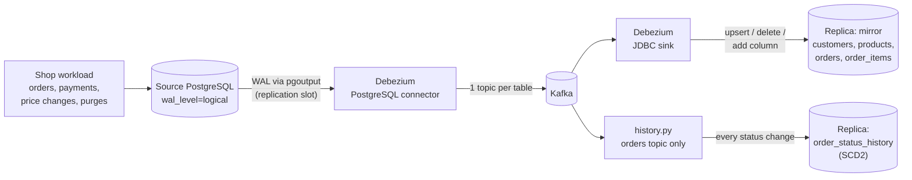

# DE-4 · Change Data Capture: PostgreSQL → Kafka → Live Replica + Order History

[](https://github.com/Frenwin/Portfolio/actions/workflows/de-04-cdc-debezium.yml)


[← Week 1 · Data Engineer](../) · [Portfolio home](../../README.md)

> Streams every insert, update and delete from a live shop database into an analytics replica within 0.5 s, without querying the shop's tables. After 8,999 transactions and a schema change mid-traffic, all four tables are **row-for-row identical** to the source.

## At a glance

| | |
| --- | --- |
| **Problem** | Analytics needs the shop's data continuously, but exports load the production database, miss deletes, and only see the latest state, so "how long did this order wait in *paid*?" cannot be answered |
| **What I built** | Debezium reads PostgreSQL's write-ahead log and publishes changes to Kafka; a JDBC sink keeps a live mirror, and a Python consumer keeps every order's status history (SCD Type 2) |
| **Result** | Replica lag p50 0.52 s / p95 0.93 s · 4 of 4 tables checksum-identical after 8,999 transactions, 464 deletes and a schema change · every order's status history kept |
| **Why it matters** | Analysts get fresh data and full history while the application database does no extra queries |
| **Run it** | `docker compose up -d --build` then `docker compose run --rm history python -m cdc.demo` |
| **Built** | 2026-11-13 in one day · Role: Data Engineer |

**Contents:** [Problem](#problem) · [Architecture](#architecture) · [Results](#results) · [What went wrong](#what-went-wrong-on-the-first-run) · [How to run](#how-to-run) · [Key decisions](#key-decisions) · [Limitations](#limitations--next-steps)

## Problem

DE-1 loaded files, DE-2 re-processed monthly exports, DE-3 consumed events the app chose to send. Most company data lives somewhere else: inside the application's own database, changing all day. Getting it out has three classic failure modes:

| Approach | What goes wrong |
| --- | --- |
| Nightly `SELECT *` export | Heavy query on production; data is a day old |
| `WHERE updated_at > :last_run` | Deleted rows never show up; two changes between runs look like one |
| Database triggers | Every application write gets slower |

Change Data Capture reads the database's own transaction log instead, so it sees **every** change, including deletes, in commit order, without touching the tables.

## Architecture



| Component | What it does |
| --- | --- |
| **Source DB** | Shop schema with `wal_level=logical`; a publication lists the replicated tables; `orders` uses `REPLICA IDENTITY FULL` so updates carry the old row |
| **Debezium source** | Takes a consistent snapshot of existing rows, then streams changes from a replication slot. Logs in as a role with only `REPLICATION` + `SELECT` |
| **JDBC sink** | Configuration only: upserts by primary key, applies deletes, adds new columns, creates tables |
| **history.py** | Keeps each status an order passed through, keyed by `(order_id, lsn)`, so replays never duplicate |
| **cdc.demo** | Seeds data, registers connectors, runs traffic with a schema change, probes lag, and compares source and replica with row-by-row checksums |

## Results

Measured on a laptop with Docker: 75,363 seeded rows, then 3 minutes of shop traffic at ~50 transactions/s with a schema change in the middle. Full output: [docs/results.md](docs/results.md).

### Replica vs source after live traffic

| Table | Source rows | Replica rows | Row-by-row checksum |
| --- | ---: | ---: | --- |
| `customers` | 5,000 | 5,000 | identical |
| `products` | 300 | 300 | identical |
| `orders` | 22,759 | 22,759 | identical |
| `order_items` | 57,162 | 57,162 | identical |

The traffic included 3,223 new orders, 3,489 status changes, 470 cancellations, 703 price changes, 650 customer moves and **464 hard deletes** (cascading to their items), all reflected in the replica.

### Speed

| Metric | Value |
| --- | ---: |
| Initial snapshot of 75,363 rows | 14.0 s |
| Replication lag p50 / p95 / max (71 probes during traffic) | **0.52 / 0.93 / 1.02 s** |
| Replica identical after traffic stopped | 0.1 s |

### Schema change mid-traffic

`ALTER TABLE customers ADD COLUMN loyalty_tier` ran on the live source. The sink added the column to the replica on the next customer change; 414 replica rows carry a value, and checksums including the new column still match.

### What the history adds

The mirror says where each order is now; the history says how it got there. 27,646 status events were recorded, and for all 22,759 orders the history's current status equals the source. Purged orders keep their full history, ending in a deletion. One query answers a question the mirror cannot:

```sql
SELECT status, percentile_cont(0.5) WITHIN GROUP (ORDER BY valid_to - valid_from) AS median_time_in_status
FROM order_status_history WHERE valid_to IS NOT NULL GROUP BY status;
```

| Status | Orders that left it | Median time in status (simulated run) |
| --- | ---: | ---: |
| pending | 283 | 42.9 s |
| paid | 173 | 38.0 s |
| packed | 183 | 49.7 s |
| shipped | 183 | 47.8 s |

The simulation moves orders in seconds; with real traffic the same query reports hours or days between payment and shipping.

## What went wrong on the first run

The first end-to-end run failed, and the failure taught more than a clean run would have:

1. **The Kafka broker stalled for ~8 s** (its own controller heartbeat timed out) about a minute after startup, while the initial snapshot was flooding it on a laptop. Kafka Connect lost its group membership; the sink's status still said `RUNNING`, but its consumer group had **no active members** and the replica stopped at 593 of 5,000 customers. *Lesson: "RUNNING" is not "consuming"; monitor consumer lag, not connector state.*
2. **Restarting the worker recovered it with no data loss.** Debezium had not finished its snapshot, so it re-ran it; the customers topic then held 10,000 messages for 5,000 rows, and the upserting sink absorbed the repeats.
3. **One table never arrived.** The sink subscribed with `topics.regex`, and `order_items` was created after the subscription; regex consumers only notice new topics on a metadata refresh, every **5 minutes** by default. The sink now lists its topics explicitly, and the single-broker setup uses one offsets partition.

## How to run

```powershell
docker compose up -d --build                                   # Kafka, Connect, source + replica Postgres, history consumer
docker compose run --rm history python -m cdc.demo             # seed, snapshot, 3 min of traffic, verify; writes docs/results.md
docker compose run --rm --no-deps -e RUN_DB_TESTS=1 history pytest -q tests   # 9 tests
```

Inspect it yourself:

```powershell
curl http://localhost:8083/connectors/shop-source/status
docker compose exec replica-db psql -U replica -c "select * from order_status_history where order_id = 20001 order by valid_from;"
```

<details>
<summary><b>Project structure</b></summary>

```text
de-04-cdc-debezium/
├── docker-compose.yml          # Kafka (KRaft), Kafka Connect + Debezium, source and replica Postgres, history consumer
├── source-db/init/01-shop.sql  # shop schema, Debezium role, publication, replica identity
├── replica-db/init/01-history.sql  # status events table + SCD2 view
├── connectors/
│   ├── shop-source.json        # Debezium PostgreSQL connector
│   └── replica-sink.json       # Debezium JDBC sink
├── cdc/
│   ├── workload.py             # simulated shop traffic + schema change
│   ├── connect.py              # registers connectors (idempotent PUT)
│   ├── history.py              # change events -> order status history
│   ├── verify.py               # row-by-row checksums, lag probes
│   └── demo.py                 # the end-to-end run
├── tests/                      # event parsing, replay-safe history, checksum sensitivity
└── docs/                       # ADR + measured results
```

</details>

## Key decisions

- **Log-based CDC over queries or triggers.** Sees deletes and every intermediate change, adds no queries or trigger work to the application. ([ADR-001](docs/adr/001-log-based-cdc.md))
- **Two consumers for two questions.** A mirror answers "what is true now"; the history answers "what happened and when". Both read the same topics independently.
- **Order by WAL position, not timestamps.** Application time and commit time come from different clocks; a test reproduces a delete that would sort before its own insert if ordered by time.
- **Proof by checksum, not by row count.** Counts can match while values differ; the verifier hashes every row's normalised values in primary-key order.
- **Least privilege.** The connector role can read and replicate, nothing else; the publication is created by the schema owner.

## Limitations & next steps

- A replication slot keeps WAL until Debezium reads it; a long outage fills the source disk. Production needs an alert on slot lag.
- `ADD COLUMN … DEFAULT` in PostgreSQL emits no row changes, so existing replica rows stay empty until they change; backfills need an explicit update.
- The mirror has no foreign keys, so parent and child rows can arrive briefly out of order.
- Single broker and single Connect worker: no fault tolerance across machines.
- Next: Avro with a schema registry, an alert on consumer lag, and an outbox pattern for domain events.

## Tech stack

Python 3.11 · PostgreSQL 16 (logical replication, `pgoutput`) · Debezium 2.7.3 (PostgreSQL source + JDBC sink) · Apache Kafka 3.8.1 (KRaft) · Kafka Connect · confluent-kafka · Docker Compose · GitHub Actions · pytest

---

[← Week 1 · Data Engineer](../) · [Portfolio home](../../README.md)
