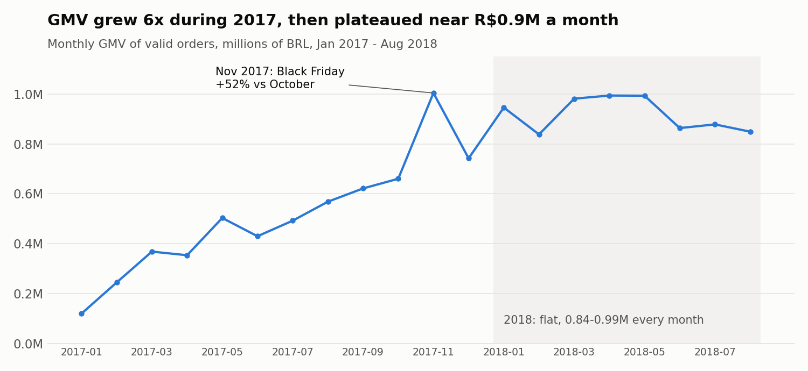
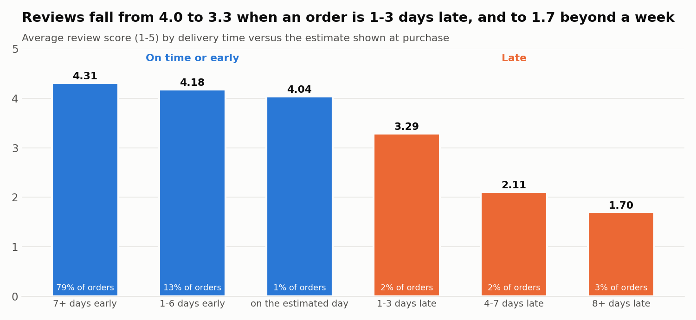

# DA-1 · SQL Case Study: 12 Business Questions on a Brazilian Marketplace


[← Week 2 · Data Analyst](../) · [Portfolio home](../../README.md)

> Twelve business questions answered in SQL on the warehouse built in [DE-1](../../01-data-engineer/de-01-elt-airflow-dbt/). The headline: **the marketplace stopped growing in 2018 because it keeps almost no customers (3% come back), and late deliveries, concentrated in the north-east and in peak weeks, cost up to 2.6 review stars.**

## At a glance

| | |
| --- | --- |
| **Question** | Where is the business growing, where is it leaking, and what should it do next? |
| **Data** | Olist marketplace, 97,910 valid orders from 94,707 customers, Jan 2017 – Aug 2018, queried from the DE-1 star schema |
| **Method** | 12 SQL queries, one technique each: LAG/LEAD, RANK, ROW_NUMBER, NTILE, running totals, FILTER, percentiles, SCD2 joins |
| **Result** | 5 findings with a recommendation each (below), backed by [every query and its output](docs/answers.md) |
| **Built** | 2026-11-16 in one day · Role: Data Analyst |

**Contents:** [Findings](#findings-and-recommendations) · [Charts](#charts) · [The 12 questions](#the-12-questions) · [How the analysis was done](#how-the-analysis-was-done) · [How to run](#how-to-run) · [Limitations](#limitations--next-steps)

## Findings and recommendations

| # | Finding | Evidence | Recommendation |
| --- | --- | --- | --- |
| 1 | **Growth has stalled.** Jan–Aug 2018 is +138% on 2017, but every 2018 month sits between R$0.84M and R$0.99M, and June–August are below March–May. | Q1, Q2 | Treat 2018 as a plateau, not a growth year; plan targets on retention, not on acquisition alone. |
| 2 | **Customers do not come back.** Only **3.0%** of 94,707 customers ordered twice; repeat customers bring 6.2% of orders. GMV growth came entirely from new customers: AOV moved +0.4%. | Q2, Q5 | Launch a second-purchase programme. The median repeat buyer returns after **28 days**, so trigger it around day 20–35. |
| 3 | **Lateness destroys reviews.** Orders delivered on the estimated day average **4.04**; 1–3 days late, **3.29**; 8+ days late, **1.70**, with 79% of those rated 1–2 stars. Meanwhile 79% of orders arrive 7+ days early. | Q7 | Protect the promise before shortening it: estimates are heavily padded, yet any miss is punished. Test tighter estimates only where lateness is rare (see 4). |
| 4 | **The north-east pays more and waits longer.** Alagoas and Maranhão see 21.5% and 17.5% late deliveries versus 4.5% in São Paulo, and freight there is 22–26% of the item price versus 13.8%. Rio de Janeiro is late on 12.1% of its 12,310 orders despite being close to São Paulo. | Q6, Q11 | Recruit sellers or a fulfilment hub in the north-east; open a carrier review for Rio de Janeiro, the second-largest source of late orders. |
| 5 | **Black Friday broke logistics.** Orders hit **7.7×** the daily baseline on 24 Nov 2017; the late rate rose from 4.6% to 17.3% that day and stayed at 16.1% for the next nine days. | Q12 | Book carrier capacity before peak weeks and widen delivery estimates for orders placed in them. |

Also worth knowing:

- **Instalments carry the big baskets.** Credit-card orders split into 7–24 instalments average R$301.74, 3.7× the R$82.62 of orders paid in full (Q9). Make interest-free instalments visible on high-price categories.
- **Revenue is concentrated.** The top 10% of sellers (303) make 67.4% of GMV (Q8); 17 of 74 categories make 80% of revenue (Q3). Key-account management for those sellers protects most of the business.
- **People shop on weekday afternoons and evenings.** Monday has 16.3% of orders, Saturday 11.0%; 73% of orders are placed after noon (Q10). Schedule campaigns and maintenance windows accordingly.

## Charts





## The 12 questions

| # | Question | Main SQL technique | Answer |
| --- | --- | --- | --- |
| [Q1](queries/q01_monthly_trend.sql) | How did GMV and orders develop month by month? | `LAG`, 3-month moving average | Grew 6× in 2017, flat in 2018 |
| [Q2](queries/q02_year_over_year.sql) | Is the business still growing year on year? | `FILTER` aggregates, unpivot | +138% GMV, +0.4% AOV |
| [Q3](queries/q03_category_pareto.sql) | Which categories drive revenue? | `RANK`, running share | 17 of 74 categories = 80% |
| [Q4](queries/q04_top_products_per_category.sql) | Top 3 products in each of the top 5 categories? | `ROW_NUMBER` per partition | No product exceeds 5.2% of its category |
| [Q5](queries/q05_repeat_customers.sql) | How many customers come back, and when? | `LEAD`, `percentile_cont` | 3.0% repeat; median 28 days |
| [Q6](queries/q06_delivery_by_state.sql) | Which states get the least reliable delivery? | SCD2 join, `RANK`, `HAVING` | AL 21.5% late vs PR 4.1% |
| [Q7](queries/q07_late_delivery_vs_reviews.sql) | What does a late delivery cost in reviews? | `CASE` buckets, share of total | 4.04 on time → 1.70 at 8+ days late |
| [Q8](queries/q08_seller_concentration.sql) | How dependent is the marketplace on top sellers? | `NTILE`, nested window aggregate | Top 10% of sellers = 67.4% of GMV |
| [Q9](queries/q09_payment_mix.sql) | How do customers pay? | stacked segmentations | 75.5% credit card; instalments ↑ AOV |
| [Q10](queries/q10_when_customers_buy.sql) | When do customers buy? | date dimension join | Monday peak, afternoons and evenings |
| [Q11](queries/q11_freight_burden.sql) | Who pays the most for shipping? | ratio of sums, `RANK` | MA 26.2% of item price vs SP 13.8% |
| [Q12](queries/q12_black_friday.sql) | What did Black Friday do to operations? | period labelling, baseline ratio | 7.7× orders, late rate ×3.8 |

Full output of every query: [docs/answers.md](docs/answers.md).

<details>
<summary><b>Example: the query behind finding 3</b></summary>

```sql
WITH bucketed AS (
    SELECT CASE
               WHEN delivery_delay_days <= -7 THEN '1. 7+ days early'
               WHEN delivery_delay_days < 0   THEN '2. 1-6 days early'
               WHEN delivery_delay_days = 0   THEN '3. on the estimated day'
               WHEN delivery_delay_days <= 3  THEN '4. 1-3 days late'
               WHEN delivery_delay_days <= 7  THEN '5. 4-7 days late'
               ELSE                                '6. 8+ days late'
           END AS delivery,
           avg_review_score
    FROM marts.fct_orders
    WHERE order_status = 'delivered' AND avg_review_score IS NOT NULL AND delivery_delay_days IS NOT NULL
      AND purchased_at >= '2017-01-01' AND purchased_at < '2018-09-01'
)
SELECT delivery,
       count(*)                                             AS orders,
       round(100.0 * count(*) / sum(count(*)) OVER (), 1)   AS share_pct,
       round(avg(avg_review_score), 2)                      AS avg_review,
       round(100.0 * avg((avg_review_score <= 2)::int), 1)  AS one_or_two_star_pct
FROM bucketed
GROUP BY delivery
ORDER BY delivery;
```

</details>

## How the analysis was done

- **One set of definitions.** GMV, AOV, valid order, customer and late delivery are defined once in [metric_definitions.md](docs/metric_definitions.md) and used by every query.
- **Complete months only.** 2016 and Sep–Oct 2018 hold under 350 orders in total; including them would show a fake collapse at the end of the series.
- **People, not order ids.** Olist creates a new `customer_id` per order, so repeat purchase is measured on `customer_unique_id`; counting `customer_id` would show a 0% repeat rate.
- **Location at the time of purchase.** State-level questions join to the SCD Type 2 customer dimension from DE-1, so customers who moved are counted where they lived when they ordered.
- **Ratios of sums, not averages of ratios.** Freight share is total freight ÷ total item value, so a R$5 item with R$20 freight does not outweigh a R$2,000 one.
- **Sanity checks on every result.** A "top 15" query returning 74 rows exposed a wrong-results case in PostgreSQL 16.16 itself (the filter vanished from the plan; 17.12 is correct). The query now uses a `MATERIALIZED` CTE; reproduction in [docs/postgres-16-window-filter.md](docs/postgres-16-window-filter.md).

## How to run

The queries read the warehouse built by DE-1.

```powershell
docker compose -f ..\..\01-data-engineer\de-01-elt-airflow-dbt\docker-compose.yml up -d postgres   # warehouse on localhost:5434
python -m venv .venv; .\.venv\Scripts\Activate.ps1
pip install -r requirements.txt
python scripts/run_queries.py      # runs queries/q*.sql, writes docs/answers.md
python scripts/make_charts.py      # writes the two charts in docs/
```

Each `.sql` file also runs on its own in any client (DBeaver, psql) against the `marts` schema.

<details>
<summary><b>Project structure</b></summary>

```text
da-01-sql-ecommerce-case-study/
├── queries/                 # q01 ... q12, one business question each
├── scripts/
│   ├── run_queries.py       # executes all queries, writes docs/answers.md + answers.json
│   └── make_charts.py       # README charts
└── docs/
    ├── metric_definitions.md
    ├── answers.md           # every question with its result table
    ├── postgres-16-window-filter.md
    └── *.png
```

</details>

## Limitations & next steps

- **Correlation, not causation.** Late orders get worse reviews, but they may also differ in product or region. Week 3 (Data Scientist) can test the effect properly.
- **Repeat rate may be understated** if returning customers use a new account; Olist's `customer_unique_id` is the best identity the data offers.
- **31% of second orders come within one day** of the first, likely split baskets rather than loyalty, so true retention is lower still.
- Next: the same questions as a Power BI dashboard ([DA-2](../da-02-powerbi-sales-dashboard/)) and as funnel and cohort analysis ([DA-3](../)).

## Data source

[Brazilian E-Commerce Public Dataset by Olist](https://www.kaggle.com/datasets/olistbr/brazilian-ecommerce) (CC BY-NC-SA 4.0), loaded and modelled in [DE-1](../../01-data-engineer/de-01-elt-airflow-dbt/).

---

[← Week 2 · Data Analyst](../) · [Portfolio home](../../README.md)
