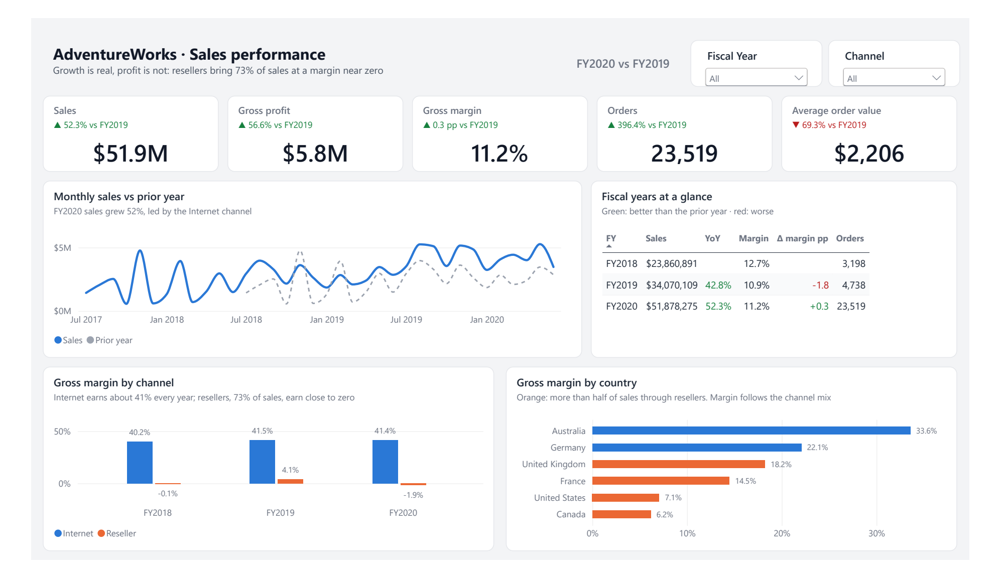
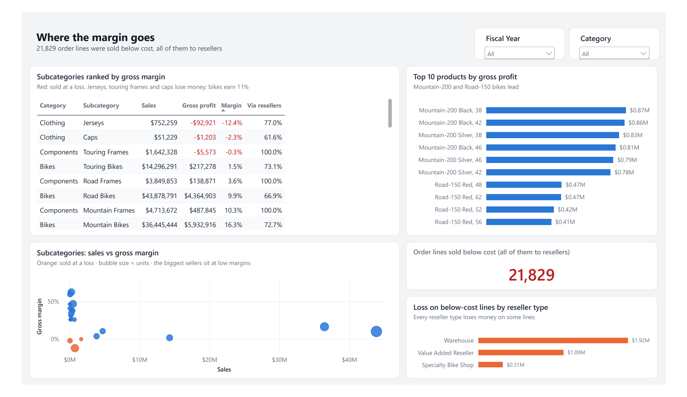
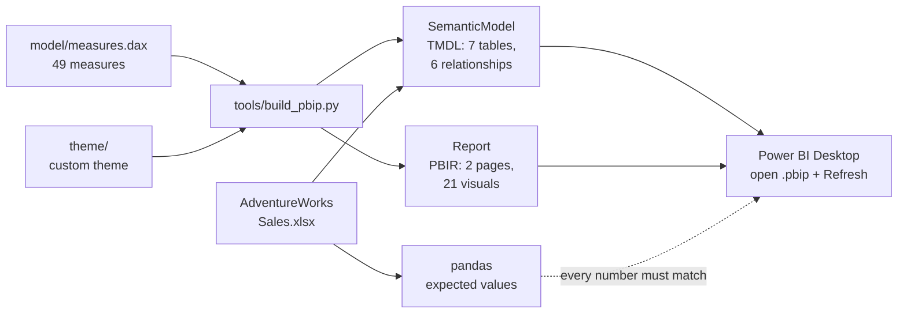

# DA-2 · Executive Sales Dashboard in Power BI


[← Week 2 · Data Analyst](../) · [Portfolio home](../../README.md)

> A two-page executive dashboard for AdventureWorks (FY2018–FY2020, 109.8M in sales). It answers one question for the sales director and CFO: **is growth profitable?** It is not: **resellers bring 73% of sales at a margin near zero**, while the Internet channel earns 41%.

## At a glance

| | |
| --- | --- |
| **Question** | Sales grew 43% and 52% in the last two years. Is that growth profitable, and if not, where does the margin go? |
| **Data** | Microsoft's AdventureWorks Sales sample: 121,253 order lines, 31,455 orders, 3 fiscal years (July–June), star schema with 6 dimensions |
| **What I built** | A two-page Power BI dashboard defined entirely as code (PBIP: TMDL model + PBIR report + custom theme), 49 DAX measures, and an independent pandas check of every number |
| **Result** | 3 findings below; every DAX value matches pandas ([validation](docs/dax-validation.md)); report and model pass Microsoft's schemas |
| **Built** | 2026-11-16 · Role: Data Analyst |

### Page 1 · Executive overview



### Page 2 · Where the margin goes



Exported from Power BI Desktop: [docs/dashboard.pdf](docs/dashboard.pdf).

### Design choices

- **Every title states a finding**, every subtitle says how to read the visual. A director reading only the titles still gets the story.
- **KPIs default to the latest fiscal year** and compare with the year before, with the change coloured green or red (`KPI Sales Delta`, `KPI Sales Color`). Picking a year in the slicer moves both.
- **Colour follows meaning, not decoration:** Internet is always blue and Reseller always orange; prior year is grey and dashed; red marks losses and declines. Colours are driven by DAX measures, so they update with the data.
- **No pie charts, gauges or 3D.** Bars are sorted by value; data labels only where the exact number matters.

## Findings

| # | Finding | Evidence | Recommendation |
| --- | --- | --- | --- |
| 1 | **Growth is unprofitable in the reseller channel.** Resellers are 73% of sales but earn −0.1%, 4.1% and −1.9% gross margin in FY2018–FY2020. Internet earns 40–42% every year. In FY2020 Internet made **112% of all profit**; resellers lost 0.67M. | Channel × fiscal year | Review reseller price lists and discount approvals before chasing more reseller volume. |
| 2 | **21,829 order lines (18%) were sold below cost, all to resellers**, losing 3.32M in total. All three reseller types sit at 0–1% margin, so this is pricing policy, not one bad partner. | Loss Lines, Loss Amount by business type | Set a floor price at standard cost in the order system; flag below-cost lines for approval. |
| 3 | **Country margins are a channel-mix effect.** Australia earns 33.6% with 15% reseller sales; Canada 6.2% with 88%. Ranked by margin, the six countries fall in exactly the reverse order of their reseller share. | Gross Margin % and Reseller Share % by country | Judge country managers on margin within each channel, not on blended margin. |

Also visible:

- **Average order value fell from 7,191 to 2,206 in FY2020** while sales rose 52%. Not a warning sign: Internet orders grew 6× (3,483 → 21,717), mostly accessories and clothing, which pulls the average down. A reminder that AOV needs a channel split to mean anything.
- **Jerseys (−12.4%), touring frames and caps are sold at a loss** across all years.
- **Data quality:** the source column `Unit Price Discount Pct` is always 0, yet 3,282 lines were sold below list price (527,508 in discounts). Discount is measured as list minus sales amount instead.

## How it is built

The whole dashboard is generated from code, so it is reviewable in a pull request and rebuilt identically every time.



| Check | Tool | Result |
| --- | --- | --- |
| Semantic model loads | Microsoft `TmdlSerializer` (AMO) | 7 tables, 6 relationships, 49 measures |
| Report files are valid | Microsoft's published PBIR JSON schemas | 30 files, 0 errors |
| Theme is valid | Power BI theme schema 2.159 | 0 errors |
| Formatting property names exist | Visual object lists in the theme schema | 0 unknown properties |
| DAX gives the right numbers | ADOMD.NET against Power BI's engine vs pandas | all values match ([details](docs/dax-validation.md)) |

| Piece | File |
| --- | --- |
| Measures (single source of truth) | [`model/measures.dax`](model/measures.dax) |
| Project generator | [`tools/build_pbip.py`](tools/build_pbip.py) |
| Schema validator | [`tools/validate_pbir.py`](tools/validate_pbir.py) |
| Custom theme | [`theme/AdventureWorksExecutive.json`](theme/AdventureWorksExecutive.json) |
| Expected values (pandas) | [`docs/expected-values.md`](docs/expected-values.md) |
| Dashboard spec | [`docs/dashboard-spec.md`](docs/dashboard-spec.md) |
| Manual build guide (for learning) | [`docs/build-guide.md`](docs/build-guide.md) |

### DAX worth a look

```dax
// Orders live on the SalesOrder dimension. Counting them through the fact table keeps the
// measure responsive to every filter on Sales; DISTINCTCOUNT on the dimension would ignore them.
Orders = COUNTROWS ( SUMMARIZE ( Sales, SalesOrder[Sales Order] ) )

// Fiscal year ends 30 June.
Sales FYTD = TOTALYTD ( [Total Sales], 'Date'[Date], "6/30" )

// KPI tiles: the selected fiscal year, or the latest one when none is selected.
KPI Fiscal Year =
IF ( HASONEVALUE ( 'Date'[Fiscal Year] ),
     VALUES ( 'Date'[Fiscal Year] ),
     CALCULATE ( MAX ( 'Date'[Fiscal Year] ), REMOVEFILTERS ( 'Date' ) ) )

KPI Sales Delta =
VAR prev = [KPI Sales PY]
VAR d = DIVIDE ( [KPI Sales] - prev, prev )
RETURN IF ( ISBLANK ( prev ), "No prior year",
            IF ( d >= 0, "▲ ", "▼ " ) & FORMAT ( ABS ( d ), "0.0%" ) & " vs " & [KPI Prior Year] )

Margin Change pp = IF ( NOT ISBLANK ( [Gross Margin PY] ), ( [Gross Margin %] - [Gross Margin PY] ) * 100 )

Profit Rank =
IF ( ISINSCOPE ( 'Product'[Product] ),
     RANKX ( ALLSELECTED ( 'Product'[Product] ), [Gross Profit], , DESC, DENSE ) )
```

## How to run

```powershell
curl.exe -L -o "data/AdventureWorks Sales.xlsx" "https://raw.githubusercontent.com/microsoft/powerbi-desktop-samples/main/AdventureWorks%20Sales%20Sample/AdventureWorks%20Sales.xlsx"
python -m venv .venv; .\.venv\Scripts\Activate.ps1; pip install -r requirements.txt
python analysis/expected_values.py        # writes docs/expected-values.md
python tools/build_pbip.py                # regenerates the .pbip project from the measures and theme
```

Open `AdventureWorks Sales Dashboard.pbip` in Power BI Desktop and press **Refresh**. If the workbook is elsewhere, change the `SourceFile` parameter (Transform data → Manage parameters). To learn the steps by hand instead, follow [the build guide](docs/build-guide.md).

## Limitations & next steps

- No sales targets exist in the sample, so the dashboard compares with the prior year rather than with a plan.
- FY2020 ends on 15 June in the data; year-on-year comparisons are against the full FY2019, so FY2020 growth is slightly understated.
- Next: row-level security by sales territory, and the same model published to the Power BI service with scheduled refresh.

## Data source

[AdventureWorks Sales sample](https://github.com/microsoft/powerbi-desktop-samples/tree/main/AdventureWorks%20Sales%20Sample), Microsoft, MIT licence.

---

[← Week 2 · Data Analyst](../) · [Portfolio home](../../README.md)
