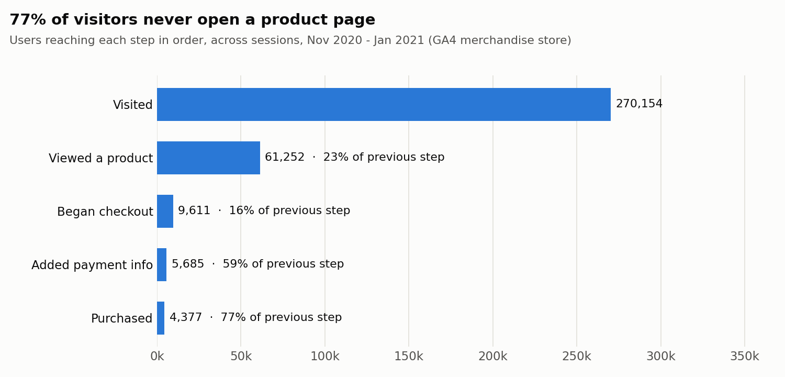
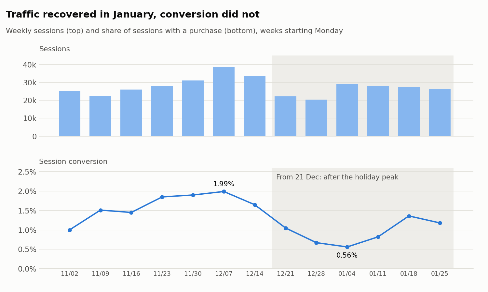
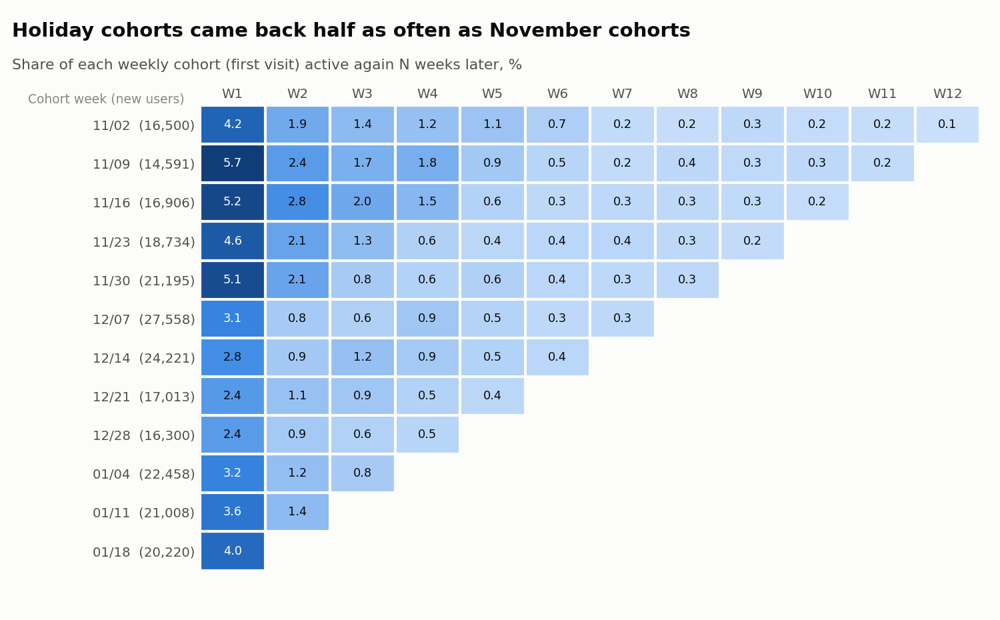
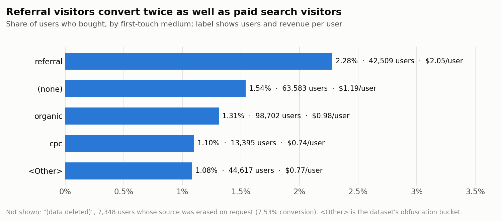

# DA-3 · GA4 Product Analytics: Purchase Funnel and Cohort Retention


[← Week 2 · Data Analyst](../) · [Portfolio home](../../README.md)

> Funnel, retention and tracking QA on the raw GA4 event export of Google's real online merchandise store, queried in BigQuery. The headline: **77% of visitors leave without opening a single product page, 41% of shoppers who begin checkout never add payment details, and new users who arrived in the holiday weeks came back about half as often as November's.** Along the way, one funnel step turned out to be broken in the tracking itself.

## At a glance

| | |
| --- | --- |
| **Question** | Where do users drop out before buying, which users come back, and can the event data be trusted? |
| **Data** | [GA4 sample e-commerce export](https://developers.google.com/analytics/bigquery/web-ecommerce-demo-dataset) of the Google Merchandise Store: 4,295,584 events, 270,154 users, 360,129 sessions, 4,419 buyers, $362,165 revenue, 1 Nov 2020 – 31 Jan 2021 |
| **Method** | 10 BigQuery SQL queries on the nested GA4 schema (`UNNEST` of event parameters and items, `_TABLE_SUFFIX` pruning), covering closed funnels, weekly cohorts, time to purchase and a tracking audit |
| **Result** | 5 findings with a recommendation each (below), a tracking bug that hides 34% of buyers from the standard funnel, and [every query with its output](docs/answers.md) |
| **Cost** | 6.2 GB scanned for all 10 queries, under 1% of BigQuery's free monthly 1 TB |
| **Built** | 2026-11-17 in one day · Role: Data Analyst |

**Contents:** [Findings](#findings-and-recommendations) · [Tracking QA](#tracking-qa-the-add_to_cart-gap) · [Charts](#charts) · [The 10 questions](#the-10-questions) · [How the analysis was done](#how-the-analysis-was-done) · [How to run](#how-to-run) · [Limitations](#limitations--next-steps)

## Findings and recommendations

| # | Finding | Evidence | Recommendation |
| --- | --- | --- | --- |
| 1 | **Most visitors never reach a product.** Of 270,154 users, only 61,252 (22.7%) ever opened a product page. Of those, 15.7% began checkout. | Q10 | Treat landing pages, not checkout, as the first bottleneck: test product-led home and campaign pages (best sellers, "shop the look") and measure the share of sessions with `view_item`. |
| 2 | **Checkout loses 41% at the payment step.** 9,611 users began checkout, 5,685 added payment info (59.2%) and 4,377 bought (77.0% of those). | Q10 | Audit the shipping and payment form: costs shown too late, forced account creation and missing wallets are the usual causes. Raising this step from 59% to 70% would add about 800 buyers, roughly **$66K** over these three months (+18%) at the average $82 per buyer. *(Estimate; it assumes later steps hold.)* |
| 3 | **Holiday shoppers do not come back.** New users from November returned in their first week at 4.2–5.7%; the cohorts from 7 Dec to 28 Dec at 2.4–3.1%. January cohorts recovered to 3.2–4.0%. | Q6 | Do not judge Q4 acquisition by its retention: plan a January win-back email for holiday buyers (gift receipt, "for yourself" offers) instead of expecting organic returns. |
| 4 | **Conversion fell to a third after Christmas while traffic recovered.** Session conversion peaked at 1.99% in the week of 7 Dec and fell to 0.56% in the week of 4 Jan, when sessions were back to 29K. | Q5 | Shipping cut-offs explain late December, but not January. Check what changed in January (promotions ended, prices, stock) before buying more traffic; until then, traffic is not the constraint. |
| 5 | **Referral visitors are worth almost 3× paid search visitors.** Users first acquired by referral bought at 2.28% and brought $2.05 each; cpc users bought at 1.10% and $0.74 each, the lowest of the named channels. | Q4 | Shift budget from cpc to referral and partner placements, and re-check cpc keywords for intent: the paid traffic converts no better than the obfuscated `<Other>` bucket. |

Also worth knowing:

- **Device is not the problem.** Desktop, mobile and tablet convert at 1.32%, 1.39% and 1.30%, with near-identical step rates (Q3). A mobile redesign would not fix the funnel.
- **Half of buyers decide in the first hour.** 49.1% of buyers whose first visit is in the data bought within 1 hour of arriving; the median is 1.1 hours (Q7). Users who took more than 7 days are more loyal: 13.2% bought again versus 8.5%. Retargeting should focus on the first day, while slower deciders are the better repeat-buyer audience.
- **One product cannot be added to the cart.** *Google Tracking Hat* had 2,893 product views and **zero** add-to-carts, against a 24.3% average for products with 2,000+ views (Q8). That is a broken page or a sold-out item still being shown. Either way it is a quick fix.

## Tracking QA: the add_to_cart gap

The textbook e-commerce funnel is *view → add to cart → checkout → payment → purchase*. Built that way, it captured only **2,637 of 4,419 buyers** (60%), so before trusting it I checked every step of the event stream (Q9):

| Check | Affected | Out of | Share |
| --- | ---: | ---: | ---: |
| Buyers who **never fired `add_to_cart`** in any session | 1,504 | 4,419 buyers | **34.0%** |
| Sessions with `begin_checkout` but no `add_to_cart` | 5,145 | 11,106 checkout sessions | **46.3%** |
| Sessions with a purchase but no `begin_checkout` | 3 | 4,848 purchase sessions | 0.1% |
| `add_to_cart` without `view_item` in the session | 15 | 15,188 cart sessions | 0.1% |
| `add_to_cart` recorded before the first `view_item` | 27 | 15,173 sessions with both | 0.2% |

Every step is consistent except `add_to_cart`: a third of buyers reached checkout and paid without it ever firing. That points to a cart path that is not tagged (for example a mini-cart or "buy now" button) rather than to user behaviour. Two consequences:

1. **The headline funnel skips the cart step.** It is built only from steps that fire reliably (view → checkout → payment → purchase) and captures 4,377 of 4,419 buyers (99%). Cart activity is still reported, but as information, not as a funnel gate.
2. **Recommendation for the tracking owner:** tag every add-to-cart entry point, then add this check to a daily data-quality job. As it stands, any dashboard that reports "cart abandonment" from this property overstates it.

## Charts









## The 10 questions

| # | Question | Main SQL technique | Answer |
| --- | --- | --- | --- |
| [Q1](queries/q01_overview.sql) | How big is the dataset? | `UNNEST(event_params)` for the session id, `COUNT(DISTINCT)` | 270K users, 360K sessions, 4,419 buyers |
| [Q2](queries/q02_session_funnel.sql) | Where do sessions drop out? (textbook funnel) | closed funnel on `MIN(IF(...))` timestamps, `UNNEST` of `STRUCT`s to unpivot | 0.76% of sessions; undercounts because of the cart gap |
| [Q3](queries/q03_funnel_by_device.sql) | Does the funnel differ by device? | `LOGICAL_OR` session flags | No: 1.30–1.39% everywhere |
| [Q4](queries/q04_conversion_by_source.sql) | Which acquisition channel brings buyers? | user-level `traffic_source`, revenue per user | Referral 2.28%, cpc 1.10% |
| [Q5](queries/q05_weekly_trend.sql) | How did traffic and conversion move each week? | `DATE_TRUNC(WEEK(MONDAY))`, `LAG` | Peak 1.99% (7 Dec), low 0.56% (4 Jan) |
| [Q6](queries/q06_weekly_cohort_retention.sql) | Do new users come back? | `first_visit` cohorts, `DATE_DIFF` in weeks | Week 1: 4–6% in Nov, 2–3% in Dec |
| [Q7](queries/q07_time_to_purchase.sql) | How long until the first purchase? | `TIMESTAMP_DIFF`, `APPROX_QUANTILES` median | 49% within 1 hour; median 1.1 h |
| [Q8](queries/q08_product_view_to_cart.sql) | Which products are viewed but not added? | `UNNEST(items)`, `HAVING`, rank | Google Tracking Hat: 0 of 2,893 |
| [Q9](queries/q09_funnel_integrity.sql) | Can the funnel be trusted? | tracking QA with combined event flags | No: 34% of buyers have no `add_to_cart` |
| [Q10](queries/q10_user_funnel.sql) | The funnel per user, across sessions | user-level closed funnel on reliable steps | 1.62% of users buy |

Full output of every query: [docs/answers.md](docs/answers.md).

<details>
<summary><b>Example: the headline funnel (Q10)</b></summary>

```sql
WITH firsts AS (
    SELECT
        user_pseudo_id,
        MIN(IF(event_name = 'view_item', event_timestamp, NULL))        AS t_view,
        MIN(IF(event_name = 'add_to_cart', event_timestamp, NULL))      AS t_cart,
        MIN(IF(event_name = 'begin_checkout', event_timestamp, NULL))   AS t_checkout,
        MIN(IF(event_name = 'add_payment_info', event_timestamp, NULL)) AS t_payment,
        MIN(IF(event_name = 'purchase', event_timestamp, NULL))         AS t_purchase
    FROM `bigquery-public-data.ga4_obfuscated_sample_ecommerce.events_*`
    WHERE _TABLE_SUFFIX BETWEEN '20201101' AND '20210131'
    GROUP BY user_pseudo_id
),
agg AS (
    SELECT
        COUNT(*)                                                                             AS users,
        COUNTIF(t_view IS NOT NULL)                                                          AS viewed,
        COUNTIF(t_checkout >= t_view)                                                        AS checked_out,
        COUNTIF(t_checkout >= t_view AND t_payment >= t_checkout)                            AS paid_info,
        COUNTIF(t_checkout >= t_view AND t_payment >= t_checkout AND t_purchase >= t_payment) AS purchased,
        COUNTIF(t_cart >= t_view)                                                            AS carted_info
    FROM firsts
)
SELECT s.step, s.n AS users,
       ROUND(100 * s.n / agg.users, 2)          AS pct_of_all_users,
       ROUND(100 * SAFE_DIVIDE(s.n, s.prev), 1) AS pct_of_previous_step
FROM agg, UNNEST([
    STRUCT('1. Visited' AS step, agg.users AS n, agg.users AS prev),
    STRUCT('2. Viewed a product', agg.viewed, agg.users),
    STRUCT('3. Began checkout', agg.checked_out, agg.viewed),
    STRUCT('4. Added payment info', agg.paid_info, agg.checked_out),
    STRUCT('5. Purchased', agg.purchased, agg.paid_info),
    STRUCT('(info) Added to cart after viewing', agg.carted_info, agg.viewed)
]) AS s
ORDER BY s.step;
```

A comparison with a NULL timestamp is NULL, and `COUNTIF` counts only TRUE, so a user who skipped a step drops out of every later step automatically. That is what makes the funnel *closed*.

</details>

## How the analysis was done

- **Raw events, not GA4 reports.** GA4 explorations can be sampled and hide their definitions. Querying the export gives exact counts and lets every definition be read in the SQL.
- **Sessions are rebuilt by hand.** GA4 has no session table: a session is `user_pseudo_id` + the `ga_session_id` event parameter, pulled out with `(SELECT value.int_value FROM UNNEST(event_params) WHERE key = 'ga_session_id')`.
- **Closed funnels on first occurrence.** Each step counts only if it happened at or after the previous step's first timestamp, so a user who paid before ever viewing a product does not inflate the "viewed" step.
- **Session and user level, side by side.** Q2 measures the funnel within a session; Q10 across all of a user's sessions. Comparing them is how the cart gap showed up: 46% of checkout sessions had no cart event even in the same session.
- **Cohorts start at `first_visit`, inside the window.** Users whose first visit happened before 1 Nov 2020 are excluded from Q6 and Q7, so every cohort is genuinely new and no one is counted with a truncated history.
- **Cost control.** Every query filters `_TABLE_SUFFIX` to prune the daily tables and selects only the columns it needs; `run_queries.py` dry-runs each query and logs bytes scanned before running it.

## How to run

You need a Google Cloud project with BigQuery enabled. The free [BigQuery sandbox](https://cloud.google.com/bigquery/docs/sandbox) is enough, with no billing account.

```powershell
gcloud auth application-default login                          # one-time browser login
python -m venv .venv; .\.venv\Scripts\Activate.ps1
pip install -r requirements.txt
$env:GCP_PROJECT = "<your-project-id>"; python scripts/run_queries.py   # ~6 GB scanned, writes docs/answers.md
python scripts/make_charts.py                                  # writes the four charts in docs/
```

Each `.sql` file also runs on its own in the BigQuery console.

<details>
<summary><b>Project structure</b></summary>

```text
da-03-ga4-funnel-cohort/
├── queries/                 # q01 ... q10, one question each
├── scripts/
│   ├── run_queries.py       # dry-run + run every query, writes docs/answers.md + answers.json
│   └── make_charts.py       # README charts
└── docs/
    ├── answers.md           # every question with its result table and bytes scanned
    ├── answers.json
    └── *.png
```

</details>

## Limitations & next steps

- **The data is obfuscated.** Google masks part of the export: `<Other>` is a bucket of hidden traffic sources, and `(data deleted)` covers 7,348 users whose source was erased on request. Their 7.5% conversion suggests these are mostly existing customers, so they are left out of the channel comparison.
- **Revenue in the last week looks wrong.** The week of 25 Jan had 312 purchasing sessions but only $5,546 revenue, about $18 per purchasing session against $70–90 in every other week. It needs checking with the store before any January revenue number is quoted.
- **First-touch attribution only.** `traffic_source` is the channel that first acquired the user, so Q4 credits referral or cpc for every later purchase. Session-level or data-driven attribution could rank channels differently.
- **Correlation, not causation.** Finding 2's $66K is a sizing estimate, not a forecast. The way to know is an A/B test of the checkout change, which is exactly what Week 3 (Data Scientist) covers.
- Next: customer segmentation and an insight deck for the marketing team ([DA-4](../)).

## Data source

[Google Analytics 4 sample e-commerce dataset](https://developers.google.com/analytics/bigquery/web-ecommerce-demo-dataset) (`bigquery-public-data.ga4_obfuscated_sample_ecommerce`), the obfuscated GA4 export of the [Google Merchandise Store](https://shop.merch.google/), public on BigQuery.

---

[← Week 2 · Data Analyst](../) · [Portfolio home](../../README.md)
