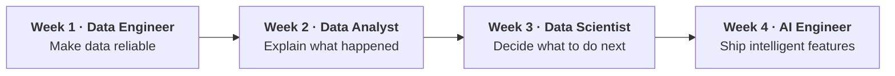

<div align="center">

# Data & AI Portfolio — 16 Projects in 4 Weeks

**Frenwin** · Data Science @ Telkom University · AI Engineer (NLP & Computer Vision)

[](#progress)
[](DEVLOG.md)
[](LICENSE)

[LinkedIn](https://www.linkedin.com/in/frenwin) · [Website](https://frenwin.vercel.app/) · [Roadmap](ROADMAP.md) · [Devlog](DEVLOG.md)

</div>

---

## Why this portfolio exists

Most portfolios show a single model in a notebook. Real data work is a chain: data has to be **collected and trusted**, then **explained**, then used to **make decisions**, and finally turned into **products**. If one link is weak, everything after it is wrong.

This repository walks that chain **one role per week**. Each project takes one to two days, uses tools that data teams actually run, and ships with runnable code, tests or evaluation, and results with real numbers.

## The four weeks at a glance



| Week | Role | Purpose | The question it answers |
| :---: | --- | --- | --- |
| 1 | [Data Engineer](01-data-engineer/) | **Make data reliable**: move, model and test data so everyone downstream can trust it | *Is the data correct, complete and on time?* |
| 2 | [Data Analyst](02-data-analyst/) | **Explain what happened**: turn tables into metrics, dashboards and recommendations | *What is happening in the business, and why?* |
| 3 | [Data Scientist](03-data-scientist/) | **Decide what to do next**: test changes, predict outcomes, measure cause and effect | *Did this change work, and what will happen if we act?* |
| 4 | [AI Engineer](04-ai-engineer/) | **Ship intelligent features**: put language and vision models into products that are evaluated and deployed | *How do we turn a model into something people can use?* |

## Progress

**4 of 16 projects done** · `████░░░░░░░░░░░░` · **Week 1 complete** · daily log in [DEVLOG.md](DEVLOG.md)

Status: ✅ Done · 🔄 In progress · ⬜ Planned

### Week 1 · Data Engineer — make data reliable

| # | Project | What it proves | Status |
| --- | --- | --- | :---: |
| DE-1 | [**Batch ELT to a star-schema warehouse**](01-data-engineer/de-01-elt-airflow-dbt/) | Orchestrated, idempotent pipeline with Airflow + dbt, 70 data tests, SCD2, CI | ✅ |
| DE-2 | [**Lakehouse with bronze/silver/gold layers**](01-data-engineer/de-02-lakehouse-spark-delta/) | 9.5M trips on S3 storage with Delta Lake; idempotent month re-loads; a MERGE redesign that cut silver time 2.6× | ✅ |
| DE-3 | [**Real-time ride event streaming**](01-data-engineer/de-03-realtime-kafka-spark/) | Kafka + Spark Structured Streaming with exactly-once results despite duplicates, late events and replays; live Grafana | ✅ |
| DE-4 | [**Change Data Capture**](01-data-engineer/de-04-cdc-debezium/) | Live replica of a shop database via the WAL: 0.5 s lag, checksum-identical after deletes and a schema change, plus full order history | ✅ |

### Week 2 · Data Analyst — explain what happened

| # | Project | What it proves | Status |
| --- | --- | --- | :---: |
| DA-1 | SQL business case study | Answering business questions with CTEs and window functions | ⬜ |
| DA-2 | Executive sales dashboard | Data modeling and DAX in Power BI | ⬜ |
| DA-3 | Product funnel & cohort retention | Product analytics on real GA4 data | ⬜ |
| DA-4 | Customer segmentation + insight deck | RFM segments turned into a campaign recommendation | ⬜ |

### Week 3 · Data Scientist — decide what to do next

| # | Project | What it proves | Status |
| --- | --- | --- | :---: |
| DS-1 | A/B test, end to end | Experiment design, power analysis, SRM checks, CUPED | ⬜ |
| DS-2 | Credit risk scoring | Explainable ML with a threshold set by business cost | ⬜ |
| DS-3 | Retail demand forecasting | Time series models backtested against a baseline | ⬜ |
| DS-4 | Marketing uplift modeling | Targeting customers who change behaviour because of a promo | ⬜ |

### Week 4 · AI Engineer — ship intelligent features

| # | Project | What it proves | Status |
| --- | --- | --- | :---: |
| AI-1 | RAG over Indonesian regulations | Retrieval with citations, measured by an evaluation set | ⬜ |
| AI-2 | Text-to-SQL analytics agent | Tool-calling agent with guardrails and tracing | ⬜ |
| AI-3 | Indonesian NLP fine-tuning | Prompting vs IndoBERT vs LoRA on accuracy, latency and cost | ⬜ |
| AI-4 | Object detection on edge | YOLO exported to ONNX and benchmarked on CPU | ⬜ |

## Latest highlights

**[DE-4 · Change Data Capture](01-data-engineer/de-04-cdc-debezium/)**: Debezium streams every insert, update and delete from a live PostgreSQL into Kafka without querying its tables.
- Replica lag **0.52 s** (p50); after 8,999 transactions, 464 hard deletes and a mid-traffic schema change, all 4 tables are **row-by-row checksum identical**.
- A second consumer keeps every order's status history (SCD2), answering "how long do orders wait in *paid*?", which a mirror cannot.
- The first run failed; the write-up shows why (a broker stall, a connector that said RUNNING while consuming nothing, a 5-minute regex-subscription blind spot) and how it was fixed.

**[DE-3 · Real-time ride streaming](01-data-engineer/de-03-realtime-kafka-spark/)**: ~1,000 events/s through Kafka and Spark with duplicates, late events, malformed messages and fraud bursts injected on purpose.
- **178,736 of 178,736** rides stored exactly once; **8 of 8** fraud bursts flagged within 6 s, with no false alerts.
- Survives `docker kill` mid-stream: after an 18 s outage, every ride was still stored once.
- Reconciliation caught a silent bug (event ids colliding across runs) that no error log showed.

**[DE-2 · Lakehouse on Delta Lake](01-data-engineer/de-02-lakehouse-spark-delta/)**: 9.55M NYC taxi trips validated into bronze/silver/gold on S3-compatible storage.
- 348K impossible trips rejected **with a reason**, not silently dropped.
- Found that one MERGE clause made every month slower than the last; redesigning it cut silver processing **from 674 s to 256 s**.

**[DE-1 · Batch ELT warehouse](01-data-engineer/de-01-elt-airflow-dbt/)**: 1.55M rows into a tested star schema in ~30 s with Airflow and dbt.
- 70 data tests; an SCD Type 2 customer dimension rebuilt from order history (252 customers moved).
- Late orders average a **2.27** review score versus **4.29** when on time.

## What you will find in every project

| Section | Why it is there |
| --- | --- |
| **Problem** | The business reason the project matters |
| **Architecture / approach** | A diagram of how it works and why these tools were chosen |
| **Results** | A table of real numbers, compared with a baseline where it applies |
| **How to run** | Five commands or fewer from a fresh clone |
| **Key decisions** | Trade-offs, so a reviewer can see the reasoning, not only the code |
| **Limitations & next steps** | What is not solved yet, stated plainly |

## Repository structure

```text
.
├── 01-data-engineer/     Week 1 projects
├── 02-data-analyst/      Week 2 projects
├── 03-data-scientist/    Week 3 projects
├── 04-ai-engineer/       Week 4 projects
├── templates/            README template used by every project
├── scripts/              new-project and daily-push helpers
├── ROADMAP.md            the full 4-week plan (Bahasa Indonesia)
└── DEVLOG.md             what was done each day
```

## License

Code is [MIT](LICENSE). Datasets keep their own licenses, listed in each project.
