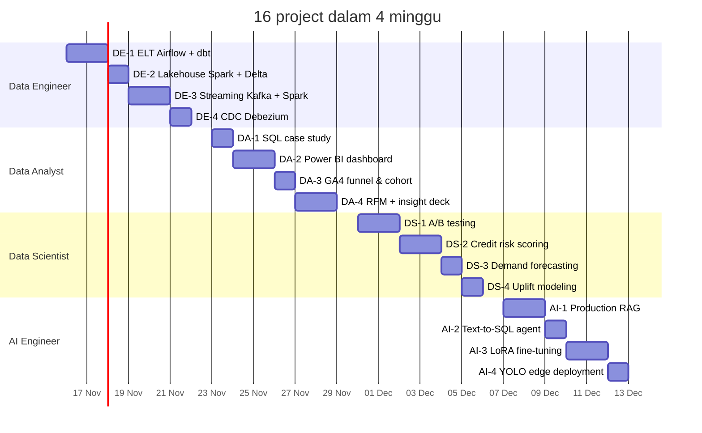

# Roadmap 4 Minggu — 16 Project Portfolio Data & AI

> **1 project setiap 1–2 hari · 4 project per minggu · 1 role per minggu.**
> Periode: **Senin, 16 Nov 2026 – Minggu, 13 Des 2026** · Owner: Frenwin

Setiap project berdiri sendiri, memakai dataset dan masalah yang biasa ditemui di industri (e-commerce, fintech, ride-hailing, retail, regulasi). Semua project ada di **satu monorepo GitHub yang di-push setiap hari**. Setiap project selesai sebagai folder ter-publish: README berisi angka hasil, kode yang bisa dijalankan, satu artefak laporan, dan demo atau screenshot.

---

## Daftar isi

1. [Kalender 16 project](#1-kalender-16-project)
2. [Skill yang dicari industri per role](#2-skill-yang-dicari-industri-per-role)
3. [Minggu 1 — Data Engineer](#3-minggu-1--data-engineer-1622-nov)
4. [Minggu 2 — Data Analyst](#4-minggu-2--data-analyst-2329-nov)
5. [Minggu 3 — Data Scientist](#5-minggu-3--data-scientist-30-nov6-des)
6. [Minggu 4 — AI Engineer](#6-minggu-4--ai-engineer-713-des)
7. [Standar output setiap project](#7-standar-output-setiap-project)
8. [Ritme kerja 1 hari & 2 hari](#8-ritme-kerja-1-hari--2-hari)
9. [Alur GitHub harian](#9-alur-github-harian)
10. [Progress tracker](#10-progress-tracker)

---

## 1. Kalender 16 project



Hari Minggu (22 Nov, 29 Nov, 6 Des, 13 Des) dipakai sebagai **buffer**: menyelesaikan project yang molor, merapikan dokumentasi, dan membuat post rekap mingguan.

| # | Tanggal | Durasi | Project | Skill industri utama | Folder |
| --- | --- | --- | --- | --- | --- |
| DE-1 | Sen–Sel, 16–17 Nov | 2 hari | Batch ELT ke data warehouse | Airflow, dbt, PostgreSQL, dimensional modeling | `de-01-elt-airflow-dbt` |
| DE-2 | Rab, 18 Nov | 1 hari | Lakehouse medallion | PySpark, Delta Lake, Parquet, partitioning | `de-02-lakehouse-spark-delta` |
| DE-3 | Kam–Jum, 19–20 Nov | 2 hari | Real-time streaming pipeline | Kafka, Spark Structured Streaming, Grafana | `de-03-realtime-kafka-spark` |
| DE-4 | Sab, 21 Nov | 1 hari | Change Data Capture | Debezium, Kafka Connect, PostgreSQL WAL | `de-04-cdc-debezium` |
| DA-1 | Sen, 23 Nov | 1 hari | SQL business case study | Window function, CTE, BigQuery SQL | `da-01-sql-ecommerce-case-study` |
| DA-2 | Sel–Rab, 24–25 Nov | 2 hari | Executive sales dashboard | Power BI, DAX, data modeling | `da-02-powerbi-sales-dashboard` |
| DA-3 | Kam, 26 Nov | 1 hari | Product funnel & cohort retention | GA4 schema, funnel, cohort, BigQuery | `da-03-ga4-funnel-cohort` |
| DA-4 | Jum–Sab, 27–28 Nov | 2 hari | Customer segmentation + insight deck | RFM, clustering, storytelling | `da-04-rfm-customer-segmentation` |
| DS-1 | Sen–Sel, 30 Nov–1 Des | 2 hari | A/B test end-to-end | Power analysis, SRM, CUPED, Bayesian test | `ds-01-ab-testing` |
| DS-2 | Rab–Kam, 2–3 Des | 2 hari | Credit risk scoring | LightGBM, SHAP, calibration, threshold bisnis | `ds-02-credit-risk-scoring` |
| DS-3 | Jum, 4 Des | 1 hari | Retail demand forecasting | Time series CV, LightGBM, baseline | `ds-03-demand-forecasting` |
| DS-4 | Sab, 5 Des | 1 hari | Marketing uplift modeling | Causal ML, T/X-learner, Qini curve | `ds-04-uplift-marketing` |
| AI-1 | Sen–Sel, 7–8 Des | 2 hari | Production RAG dokumen regulasi | Hybrid search, reranker, RAG evaluation | `ai-01-rag-regulasi-indonesia` |
| AI-2 | Rab, 9 Des | 1 hari | Text-to-SQL analytics agent | Tool calling, guardrails, tracing | `ai-02-text-to-sql-agent` |
| AI-3 | Kam–Jum, 10–11 Des | 2 hari | Fine-tuning NLP Bahasa Indonesia | LoRA/PEFT, IndoBERT, evaluation | `ai-03-indonesian-nlp-lora` |
| AI-4 | Sab, 12 Des | 1 hari | Object detection di edge | YOLO, ONNX, benchmark latency | `ai-04-yolo-edge-deployment` |

**Struktur folder:** setiap project menjadi subfolder di folder role-nya, misalnya `01-data-engineer/de-01-elt-airflow-dbt/`. Buat dengan `scripts/new-project.ps1` (lihat [Alur GitHub harian](#9-alur-github-harian)).

---

## 2. Skill yang dicari industri per role

Daftar ini disusun dari requirement yang paling sering muncul di lowongan Data/AI (startup, e-commerce, fintech, dan bank di Indonesia serta remote global). Kolom kanan menunjukkan project yang membuktikan skill tersebut.

| Role | Skill inti yang sering diminta | Dibuktikan di |
| --- | --- | --- |
| Data Engineer | SQL + Python | semua DE |
| | Orchestration (Airflow) | DE-1 |
| | Transformasi & modeling (dbt, star schema, SCD) | DE-1 |
| | Data warehouse (PostgreSQL; BigQuery / Snowflake sebagai next step) | DE-1 |
| | Big data processing (Spark) & lakehouse (Delta / Iceberg) | DE-2, DE-3 |
| | Streaming (Kafka) & CDC | DE-3, DE-4 |
| | Data quality, Docker, CI/CD | semua DE |
| Data Analyst | SQL lanjutan (window function, CTE) | DA-1, DA-3 |
| | BI tool (Power BI / Tableau / Looker Studio) | DA-2 |
| | Product analytics (funnel, cohort, retention) | DA-3 |
| | Segmentasi pelanggan & business metrics | DA-4 |
| | Storytelling & presentasi ke stakeholder | DA-2, DA-4 |
| Data Scientist | Statistik & experimentation (A/B testing) | DS-1 |
| | Supervised ML + explainability (SHAP) | DS-2 |
| | Evaluasi berbasis biaya bisnis, bukan hanya akurasi | DS-2, DS-4 |
| | Time series forecasting | DS-3 |
| | Causal inference / uplift | DS-1, DS-4 |
| AI Engineer | LLM application: RAG, vector search | AI-1 |
| | Agent & tool calling, guardrails | AI-2 |
| | Evaluasi LLM / model (bukan hanya demo) | AI-1, AI-2, AI-3 |
| | Fine-tuning efisien (LoRA / PEFT) | AI-3 |
| | Computer vision + deployment teroptimasi (ONNX) | AI-4 |
| | Serving & MLOps (FastAPI, Docker, CI, monitoring) | semua AI |

---

## 3. Minggu 1 — Data Engineer (16–22 Nov)

### DE-1 · Batch ELT ke Data Warehouse — Sen–Sel, 16–17 Nov (2 hari) · **Selesai 10 Nov** → [lihat project](01-data-engineer/de-01-elt-airflow-dbt/)

- **Kenapa industri butuh:** pola Airflow + dbt + warehouse adalah stack data engineering paling umum di perusahaan modern.
- **Dataset:** [Olist Brazilian E-Commerce](https://www.kaggle.com/datasets/olistbr/brazilian-ecommerce).
- **Stack:** Docker Compose, Airflow, PostgreSQL, dbt, GitHub Actions (BigQuery sebagai target tambahan di next steps).
- **Scope MVP:** DAG ingestion yang idempotent → schema `raw` → dbt `staging` → `marts` (`fct_orders`, `dim_customers` SCD2 dari riwayat order, `dim_products`, `dim_date`) → dbt tests.
- **Output:** README dengan diagram arsitektur + ERD, dbt docs, CI yang menjalankan `dbt build`, data dictionary.
- **Stretch:** Terraform untuk dataset BigQuery, alert Slack saat DAG gagal.

### DE-2 · Lakehouse Medallion — Rab, 18 Nov (1 hari)

- **Kenapa industri butuh:** arsitektur lakehouse (Databricks, Delta, Iceberg) menggantikan data lake mentah di banyak perusahaan.
- **Dataset:** [NYC TLC Trip Record Data](https://www.nyc.gov/site/tlc/about/tlc-trip-record-data.page) (Parquet, puluhan juta baris).
- **Stack:** PySpark, Delta Lake, MinIO (S3-compatible) di Docker.
- **Scope MVP:** bronze (raw) → silver (dibersihkan, dedup, schema enforcement) → gold (agregat per zona/jam); partitioning + `MERGE` upsert + time travel.
- **Output:** README dengan perbandingan waktu query sebelum/sesudah partitioning, notebook atau job script.

### DE-3 · Real-time Streaming Pipeline — Kam–Jum, 19–20 Nov (2 hari)

- **Kenapa industri butuh:** ride-hailing, fintech, dan e-commerce memproses event secara real-time (fraud, surge pricing, monitoring).
- **Dataset:** generator event transaksi/perjalanan buatan sendiri (Python producer).
- **Stack:** Kafka, Spark Structured Streaming, PostgreSQL, Grafana.
- **Scope MVP:** producer → topic Kafka → windowed aggregation + watermark untuk late data → sink ke PostgreSQL → dashboard Grafana real-time + aturan alert sederhana (mis. transaksi mencurigakan).
- **Output:** README dengan diagram, throughput (events/detik) dan latency end-to-end, GIF dashboard.

### DE-4 · Change Data Capture — Sab, 21 Nov (1 hari)

- **Kenapa industri butuh:** CDC adalah cara standar menyalin database operasional ke warehouse tanpa membebani database produksi.
- **Stack:** PostgreSQL (logical replication), Debezium, Kafka Connect, sink ke PostgreSQL/warehouse.
- **Scope MVP:** insert/update/delete di database sumber → tereplikasi otomatis ke target, termasuk penanganan perubahan schema.
- **Output:** README dengan diagram, skrip demo `make demo`, GIF replikasi berjalan.

---

## 4. Minggu 2 — Data Analyst (23–29 Nov)

### DA-1 · SQL Business Case Study — Sen, 23 Nov (1 hari)

- **Kenapa industri butuh:** SQL adalah skill nomor satu di hampir semua tes teknis Data Analyst.
- **Dataset:** BigQuery public dataset `bigquery-public-data.thelook_ecommerce`.
- **Scope MVP:** 10–12 pertanyaan bisnis (GMV bulanan, top kategori, repeat rate, AOV per channel, running total, ranking produk per kategori, MoM growth) diselesaikan dengan CTE dan window function.
- **Output:** README berformat pertanyaan → query → jawaban → insight 1 kalimat; folder `queries/`.

### DA-2 · Executive Sales Dashboard — Sel–Rab, 24–25 Nov (2 hari)

- **Kenapa industri butuh:** Power BI adalah BI tool yang paling banyak diminta di lowongan Data Analyst di Indonesia, terutama korporat dan perbankan.
- **Dataset:** [AdventureWorks sample](https://learn.microsoft.com/en-us/sql/samples/adventureworks-install-configure) (Microsoft).
- **Stack:** Power BI Desktop, DAX, Power Query.
- **Scope MVP:** star schema di model Power BI, measure DAX (YoY, YTD, margin, target vs aktual), 2 halaman: Executive Overview & Product/Region drill-down.
- **Output:** file `.pbix`, PDF export, screenshot/GIF di README, daftar measure DAX dengan penjelasan.

### DA-3 · Product Funnel & Cohort Retention — Kam, 26 Nov (1 hari)

- **Kenapa industri butuh:** analisis funnel dan retention adalah pekerjaan harian Product Analyst di startup.
- **Dataset:** BigQuery public dataset `ga4_obfuscated_sample_ecommerce` (schema GA4 asli).
- **Scope MVP:** funnel view → add to cart → checkout → purchase per device/channel, cohort retention mingguan, identifikasi tahap dengan drop-off terbesar.
- **Output:** README dengan chart funnel + heatmap cohort, 3 rekomendasi produk.

### DA-4 · Customer Segmentation + Insight Deck — Jum–Sab, 27–28 Nov (2 hari)

- **Kenapa industri butuh:** tim marketing dan CRM butuh segmen pelanggan yang bisa langsung dieksekusi menjadi campaign.
- **Dataset:** [Online Retail II (UCI)](https://archive.ics.uci.edu/dataset/502/online+retail+ii).
- **Stack:** Python (Pandas, scikit-learn), Plotly, Google Slides/PowerPoint.
- **Scope MVP:** pembersihan data, RFM scoring, K-Means sebagai pembanding, profil tiap segmen, estimasi nilai campaign per segmen.
- **Output:** insight deck 8–10 slide (masalah → temuan → rekomendasi → dampak), notebook, README.

---

## 5. Minggu 3 — Data Scientist (30 Nov–6 Des)

### DS-1 · A/B Test End-to-End — Sen–Sel, 30 Nov–1 Des (2 hari)

- **Kenapa industri butuh:** experimentation adalah inti pekerjaan Data Scientist di perusahaan produk digital.
- **Dataset:** [Cookie Cats A/B test](https://www.kaggle.com/datasets/yufengsui/mobile-games-ab-testing) + data simulasi untuk CUPED.
- **Stack:** Python, SciPy, Statsmodels, Streamlit.
- **Scope MVP:** experiment design doc (hipotesis, metrik primer + guardrail, MDE, power analysis), SRM check, uji frekuentis + bootstrap CI, Bayesian Beta-Binomial, CUPED pada data simulasi, bahaya *peeking*.
- **Output:** decision memo 1 halaman (ship / tidak ship), notebook, Streamlit sample-size calculator ter-deploy.

### DS-2 · Credit Risk Scoring — Rab–Kam, 2–3 Des (2 hari)

- **Kenapa industri butuh:** fintech lending dan bank adalah salah satu perekrut Data Scientist terbesar di Indonesia.
- **Dataset:** [Home Credit Default Risk](https://www.kaggle.com/competitions/home-credit-default-risk).
- **Stack:** Pandas, LightGBM, SHAP, scikit-learn, MLflow.
- **Scope MVP:** feature engineering dari tabel relasional, baseline logistic regression vs LightGBM, ROC-AUC + KS + Gini, kalibrasi probabilitas, threshold berdasarkan expected loss, penjelasan SHAP.
- **Output:** README dengan tabel metrik, chart SHAP, simulasi approval rate vs default rate; model card.

### DS-3 · Retail Demand Forecasting — Jum, 4 Des (1 hari)

- **Kenapa industri butuh:** forecasting permintaan menentukan stok, logistik, dan staffing di retail dan FMCG.
- **Dataset:** [Store Sales – Time Series Forecasting (Favorita)](https://www.kaggle.com/competitions/store-sales-time-series-forecasting) (subset beberapa toko/kategori).
- **Stack:** Pandas, LightGBM, statsforecast.
- **Scope MVP:** baseline seasonal naive → model statistik → LightGBM dengan lag & holiday features, backtesting rolling-origin, MAPE/WAPE per kategori.
- **Output:** README dengan tabel perbandingan model vs baseline dan chart forecast.

### DS-4 · Marketing Uplift Modeling — Sab, 5 Des (1 hari)

- **Kenapa industri butuh:** perusahaan ingin tahu siapa yang *berubah perilaku karena* promo, bukan siapa yang memang akan membeli.
- **Dataset:** [Hillstrom Email Marketing](https://blog.minethatdata.com/2008/03/minethatdata-e-mail-analytics-and-data.html).
- **Stack:** causalml atau scikit-uplift.
- **Scope MVP:** T-learner vs X-learner, Qini/uplift curve, simulasi profit jika promo hanya dikirim ke top 30% uplift.
- **Output:** README dengan Qini curve dan tabel profit per strategi targeting.

---

## 6. Minggu 4 — AI Engineer (7–13 Des)

### AI-1 · Production RAG Dokumen Regulasi Indonesia — Sen–Sel, 7–8 Des (2 hari)

- **Kenapa industri butuh:** RAG adalah aplikasi LLM yang paling banyak dibangun perusahaan (knowledge base internal, customer service, compliance).
- **Dataset:** dokumen regulasi publik berbahasa Indonesia (mis. UU Pelindungan Data Pribadi, POJK) dalam PDF.
- **Stack:** LLM API atau open model via Ollama, embedding multilingual, Qdrant/pgvector, BM25 + reranker, FastAPI, Docker.
- **Scope MVP:** parsing PDF + chunking per pasal, hybrid search + reranking, jawaban dengan sitasi pasal, evaluation set 30 pertanyaan (faithfulness, context recall, answer correctness).
- **Output:** README dengan arsitektur, tabel evaluasi (naive RAG vs hybrid + reranker), demo, `docker compose up`.

### AI-2 · Text-to-SQL Analytics Agent — Rab, 9 Des (1 hari)

- **Kenapa industri butuh:** agent yang memakai tool (database, API) adalah arah utama aplikasi LLM di 2026.
- **Dataset:** database e-commerce dari DA-1 atau DE-1.
- **Stack:** LLM dengan tool calling, PostgreSQL/BigQuery, tracing (Langfuse atau sejenisnya).
- **Scope MVP:** agent membaca schema → menulis SQL → mengeksekusi lewat koneksi **read-only** → menjawab dengan tabel/angka; guardrail (blok DDL/DML, limit baris); eval set 25 pertanyaan dengan execution accuracy.
- **Output:** README dengan akurasi eval, contoh trace, daftar failure case, demo.

### AI-3 · Fine-tuning NLP Bahasa Indonesia — Kam–Jum, 10–11 Des (2 hari)

- **Kenapa industri butuh:** perusahaan perlu memilih antara prompting, fine-tuning model kecil, atau LLM besar berdasarkan akurasi, biaya, dan latency.
- **Dataset:** [IndoNLU SmSA (sentiment)](https://github.com/IndoNLP/indonlu) atau NERGrit (NER).
- **Stack:** Hugging Face Transformers, PEFT (LoRA), IndoBERT, Google Colab/Kaggle GPU.
- **Scope MVP:** bandingkan (1) zero/few-shot LLM, (2) fine-tune IndoBERT, (3) LoRA pada small LLM → tabel F1 vs latency vs biaya per 1.000 request.
- **Output:** model di Hugging Face Hub + model card, README dengan tabel perbandingan dan error analysis.

### AI-4 · Object Detection di Edge — Sab, 12 Des (1 hari)

- **Kenapa industri butuh:** CV di industri (manufaktur, keselamatan kerja, retail) harus jalan cepat di hardware terbatas, bukan hanya akurat di notebook.
- **Dataset:** dataset publik helm/APD (Personal Protective Equipment) dari Roboflow Universe.
- **Stack:** Ultralytics YOLO, ONNX Runtime, Gradio.
- **Scope MVP:** fine-tune YOLO, export ke ONNX + quantization, benchmark mAP vs FPS di CPU (PyTorch vs ONNX), demo Gradio di Hugging Face Spaces.
- **Output:** README dengan tabel mAP/FPS/ukuran model, GIF deteksi, demo publik.

---

## 7. Standar output setiap project

Karena tiap project hanya 1–2 hari, standarnya dibuat **minimal tapi tetap profesional**. Project dianggap selesai hanya jika checklist ini terpenuhi.

**Wajib (setiap project):**

- [ ] Folder project dengan nama sesuai tabel kalender; kolom Status di `README.md` utama dan README role diperbarui
- [ ] `README.md` sesuai template di bawah, dengan **minimal satu tabel hasil berangka**
- [ ] Kode yang bisa dijalankan: `requirements.txt` / `pyproject.toml`, atau `docker compose up`, plus `.env.example`
- [ ] Satu artefak utama: diagram arsitektur (DE), dashboard/deck (DA), memo/laporan (DS), demo/eval report (AI)
- [ ] Screenshot atau GIF di README
- [ ] `LICENSE` (MIT)

**Disarankan:**

- [ ] Tests + GitHub Actions (wajib untuk DE dan AI)
- [ ] Demo publik (Streamlit Cloud, Hugging Face Spaces, Looker Studio, GitHub Pages)
- [ ] Post LinkedIn per project, atau satu post carousel rekap tiap hari Minggu

**Template README:**

```markdown
# <Nama Project>

> <Satu kalimat: masalah bisnis + hasil utama dengan angka.>


## Problem
Kenapa ini penting bagi bisnis (2–3 kalimat).

## Approach
Diagram arsitektur atau alur metode + alasan pemilihan teknik.

## Results
| Metric | Baseline | This project |
| --- | --- | --- |

## How to Run
Langkah dari clone sampai jalan (≤ 5 perintah).

## Project Structure

## Limitations & Next Steps

## Tech Stack
```

---

## 8. Ritme kerja 1 hari & 2 hari

**Project 1 hari (±8 jam):**

| Jam | Kegiatan |
| --- | --- |
| 1 | Baca ulang scope MVP, siapkan repo dari template, unduh data |
| 2–5 | Build inti (pipeline / analisis / model) |
| 6 | Hasilkan angka, chart, dan artefak utama |
| 7–8 | README, screenshot/GIF, push, publish demo |

**Project 2 hari:**

| Hari | Kegiatan |
| --- | --- |
| 1 | Setup, data, build inti sampai versi pertama berjalan end-to-end |
| 2 (pagi) | Evaluasi, perbaikan, stretch goal bila waktu cukup |
| 2 (sore) | README, artefak, demo, publish |

**Aturan main:**

- **Timebox ketat.** Jika belum selesai di akhir jatah hari, potong scope dan masukkan sisanya ke "Next Steps" di README. Buffer hari Minggu hanya untuk menyelesaikan publish.
- **Angka asli saja.** Semua angka di README dan CV berasal dari hasil run yang bisa direproduksi.
- **Commit setiap hari** agar contribution graph mencerminkan konsistensi.
- **Template sudah siap** di `templates/` dan `scripts/new-project.ps1`, jadi setiap project baru dibuat dengan satu perintah.

---

## 9. Alur GitHub harian

Semua project ada di satu repo publik. **Push minimal sekali sehari**, termasuk hari buffer, supaya contribution graph dan `DEVLOG.md` menunjukkan progres harian.

| Kapan | Perintah (dari root repo) | Hasil |
| --- | --- | --- |
| Mulai project | `powershell -ExecutionPolicy Bypass -File scripts\new-project.ps1 -Role 01-data-engineer -Name de-01-elt-airflow-dbt -Title "Batch ELT with Airflow and dbt"` | folder project + README dari template |
| Setiap satu bagian selesai (min. 1× sehari) | `powershell -ExecutionPolicy Bypass -File scripts\daily-push.ps1 -Message "DE-1: dbt staging models + tests"` | entri baru di `DEVLOG.md`, commit, push |
| Project selesai | ubah Status menjadi `Done` di `README.md` dan README role, lalu daily-push dengan pesan `DE-1: done — <hasil utama>` | progres terlihat di halaman depan repo |

- **Format pesan commit:** `<ID project>: <apa yang selesai>`, misalnya `DS-2: LightGBM + SHAP, hasil vs baseline di README`.
- **Commit kecil dan sering** lebih baik daripada satu commit besar di malam hari.
- **Data mentah dan file model tidak di-commit** (sudah diatur di `.gitignore`). Tulis cara download data di README project.
- **Folder `CV/` tidak pernah di-push** karena berisi nomor HP dan email.
- Commit hanya terhitung di contribution graph jika email commit terdaftar di akun GitHub-mu.

---

## 10. Progress tracker

**Minggu 1 — Data Engineer**
- [x] DE-1 `de-01-elt-airflow-dbt`
- [ ] DE-2 `de-02-lakehouse-spark-delta`
- [ ] DE-3 `de-03-realtime-kafka-spark`
- [ ] DE-4 `de-04-cdc-debezium`

**Minggu 2 — Data Analyst**
- [ ] DA-1 `da-01-sql-ecommerce-case-study`
- [ ] DA-2 `da-02-powerbi-sales-dashboard`
- [ ] DA-3 `da-03-ga4-funnel-cohort`
- [ ] DA-4 `da-04-rfm-customer-segmentation`

**Minggu 3 — Data Scientist**
- [ ] DS-1 `ds-01-ab-testing`
- [ ] DS-2 `ds-02-credit-risk-scoring`
- [ ] DS-3 `ds-03-demand-forecasting`
- [ ] DS-4 `ds-04-uplift-marketing`

**Minggu 4 — AI Engineer**
- [ ] AI-1 `ai-01-rag-regulasi-indonesia`
- [ ] AI-2 `ai-02-text-to-sql-agent`
- [ ] AI-3 `ai-03-indonesian-nlp-lora`
- [ ] AI-4 `ai-04-yolo-edge-deployment`

**Penutup (Min, 13 Des)**
- [ ] Status 16 project di `README.md` menjadi `Done`, repo di-pin di profil GitHub, dan profile README menautkan repo ini
- [ ] Isi angka asli di CV, buat 3 varian CV (AI Engineer, Data Scientist, Data Engineer/Analyst)
